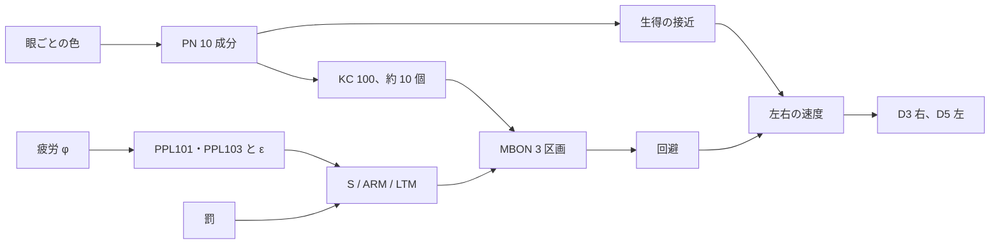

# 数理モデル

この文書は `brain/`、`sim/`、`robot/` が実際に計算しているものを式にしたものである。数値はソースの既定値で、各ブロックの末尾にファイルと関数を置く。記憶の時定数は測定値ではなく仮定である（`brain/constants.py` のモジュールコメント）。古いメモとコードが違うところはコードを採り、[末尾](#コードと古い文書)に違いをまとめた。画面の操作は [robot/README.md](../robot/README.md) にあり、ここには書かない。

時間の単位は三つある。**ロボット秒**は `Brain.t` と実機の壁時計である。**生物分**は $`t_{\mathrm{bio}}=t\cdot\mathrm{compression}`$ で、記憶の ODE、窓・門・消去・疲労、適格痕跡、罰の幅、不応期、手順の長さが使う。**原生秒**は `DAN2.step` に渡す時間である。脳はロボット秒の刻みに圧縮を掛けて渡す。圧縮 1 では、ロボット秒と生物分と原生秒が同じ数値になる。

## 1. 全体像

左右の眼はそれぞれ長さ 10 の投射ニューロン（PN）ベクトルになる。ケニヨン細胞（KC）が読むのは先頭 9 成分（色相 8 ビンと明るさ）である。100 個の KC が k-winners でおよそ 10 個立ち、3 区画の MBON を押さえる。回避の強さは、その MBON を静的な重み 0.21 / 0.46 / 0.33 で足したものである。光への接近は MBON を通らない。明るさの交差項で、右が明るければ左の車輪が速くなる。左右の回避が揃って強いときは、その対の共通な前進を消したうえで後退を引き、差が小さいあいだは保持した旋回を足す。

ドーパミン振動子は PPL101（MP1）と PPL103（MV1）の 2 細胞だけである。3 区画目（α′2α2、PPL105）に対応する細胞は無く、その区画の忘却駆動は常に 0 である。振動子は車輪を直接は回さない。痕跡 S / ARM / LTM を通して KC→MBON の重みを変え、集中学習の疲労 $`\varphi`$ として自分の入力に戻る。



罰は、直前までの適格痕跡が立っている KC にだけ、3 区画の S を同時に足す。周が開いているかは、この書き込みを止めない。左右の眼は一つのキノコ体を共有し、記憶に渡す KC は両眼の要素ごとの最大である。回避の読み出しだけ眼ごとに分かれる。LTM を書くのは、前の休息が 10 生物分以上だった周の終わりから 10 生物分だけである。1 周目にはその隙間が無い。

出典: `brain/coding.py` `pn_code`、`brain/memory.py` `MB`、`brain/dan.py` `DAN2`、`brain/wheels.py` `wheel_speeds`、`brain/brain.py` `Brain.step`。

## 2. 変数と記号

既定値は引数を省略したときの値である。`make_brain(seed)` は振動子セットを `seed % 4` で選び、圧縮は `DEFAULT_COMPRESSION` である（`brain/brain.py` `make_brain`）。

### 時間と大きさ

| 記号 | 意味 | 単位 | 既定 | 場所 |
|---|---|---|---|---|
| $`\Delta t`$ | 脳の一歩 | ロボット秒 | 0.02（50 Hz） | `TICK_S`。アリーナの引数 `dt` も 0.02 |
| $`\mathrm{compression}`$ | 生物分 / ロボット秒 | 生物分/s | 5 | `DEFAULT_COMPRESSION`。実機は `config.COMPRESSION` が同じ値を読む |
| $`t`$ | ロボット時刻 | ロボット秒 | 0 | `Brain.t` |
| $`t_{\mathrm{bio}}=t\cdot\mathrm{compression}`$ | 生物時刻 | 生物分 | 0 | `Brain.bio_min` |
| $`n_{\mathrm{KC}}`$ | KC 数 | 個 | 100 | `N_KC` |
| $`n_{\mathrm{PN}}`$ | KC が読む PN 数 | 個 | 9 | `N_PN` |
| $`c`$ | 1 KC の爪の本数 | 本 | 4 | `N_CLAWS` |
| $`k`$ | 残す KC 数 | 個 | 10 | `K_ACTIVE` |
| 区画数 | S / A / L の行 | 個 | 3 | `N_COMPARTMENTS` |

変えたいときは `brain/constants.py` の `DEFAULT_COMPRESSION` だけを変える。0 以下は、脳の中では 1 として扱う。`robot_seconds(bio, compression)` は `bio / compression` である。

### 入力

| 記号 | 意味 | 単位 | 既定 | 場所 |
|---|---|---|---|---|
| 色相ビン | 8 ビンの中心 | 度 | $`0,45,\ldots,315`$ | `HUES` |
| $`\sigma_h`$ | 色相ガウスの幅 | 度 | 30 | `HUE_SIGMA` |
| CS+ / CS− | 脳へ渡す色相 | 度 | 0（赤、罰）/ 240（青、安全） | `CS_PLUS_HUE`、`CS_MINUS_HUE` |
| $`p\in\mathbb{R}^{10}`$ | 1 眼の PN | 混合 | — | `pn_code` |
| 床 | これ未満は KC なし | 明るさ | 0.03 | `KC_FLOOR` |
| カメラ更新 | 眼の読み直し | ロボット秒 | 0.10 | `COUNT_S` |
| `COLOR_GAIN` | 画素割合の倍率 | 無次元 | 1 | `config.COLOR_GAIN` |
| `fraction_floor` | これ未満の眼は PN に渡さない | 割合 | 0.05 | `color_thresholds.json` |
| 領域の床 | これ未満の連結領域は捨てる | フレーム比 | 0.002 | `REGION_MIN_FRACTION` |
| 計数幅 | これより広いフレームは縮める | 画素 | 320 | `COUNT_W` |

$`p_0,\ldots,p_7`$ が色相、$`p_8`$ が重みの合計（明るさ）、$`p_9=\sqrt{p_8}`$ である。$`p_9`$ は KC も車輪も読まない。`coding.py` は、古い軌跡と桁を揃えるために残してある、と書いている。カメラが測った色相は PN に渡らない。窓を通った赤は 0°、青は 240° として符号化する。

### 読み出しと罰

| 記号 | 意味 | 単位 | 既定 | 場所 |
|---|---|---|---|---|
| $`g`$ | 区画の回避重み | 無次元 | $`(0.21,\ 0.46,\ 0.33)`$ | `GAINS` |
| $`\delta`$ | KC→MBON の抑圧 | 無次元 | 0.8 | `MEMORY["delta"]` |
| $`\eta_p`$ | 罰 1 回の増分 | 無次元 | 0.13 | `MEMORY["eta_p"]` |
| $`\tau_e`$ | 適格痕跡 | 生物分 | 2 | `MEMORY["tau_e"]` |
| 不応期 | 罰の最短間隔 | 生物分 | 1 | `SHOCK_REFRACTORY_S`。ロボット秒は `Brain.refractory_s` $`=1/\mathrm{compression}`$ |
| $`u_{\mathrm{ext}}`$ の初期 | 罰パルスの高さ | 無次元 | 1.5 | `SHOCK_DRIVE` |
| 罰の減衰 | $`u_{\mathrm{ext}}`$ の傾き | 1/生物分 | 5 | `SHOCK_DECAY`。`_signals` はロボット秒の刻みに圧縮を掛ける |

$`g`$ は float32 で、和は 1 になる。対応は γ1pedc ← PPL101、γ2α′1 ← PPL103、α′2α2 ← PPL105（`constants.py` のコメント）。圧縮 5 では不応期が 0.2 ロボット秒、高さ 1.5 のパルスは $`1.5/5=0.3`$ 生物分なので 0.06 ロボット秒で 0 になる。

### 振動子

| 記号 | 意味 | 単位 | 既定 | 場所 |
|---|---|---|---|---|
| $`D_i, a_i`$ | 細胞 $`i`$ の活動と順応 | 無次元 | 下記 | `DAN2.D`、`DAN2.a` |
| $`\tau`$ | $`D`$ の時定数 | 原生秒 | 0.1 | `DAN2` の `tau` |
| $`\tau_a`$ | 順応の時定数 | 原生秒 | セット表 | `DAN2.tau_a` |
| $`\varepsilon`$ | 拡散結合 | 無次元 | 0.1 | `Brain` の `eps` |
| $`o`$ | 疲労からのバイアス | 無次元 | $`-0.5\,\varphi`$ | `Brain._signals` |
| $`\mathrm{het}`$ | 2 細胞をずらす | — | 真 | `DAN2` |

細胞 0 が PPL101、細胞 1 が PPL103 である。`DAN2` を単体で作ると $`D=(4,\ 1.2)`$、$`a=(1,\ 1)`$ から始まる。`Brain` はこれを上書きし、$`D_0=4`$、$`D_1=1+U`$ とする。$`U`$ は `default_rng(seed)` の最初の `random()` で、$`[0,1)`$ に入る。したがって $`D_1\in[1,2)`$ である（`Brain.__init__`）。

セット $`(g_s,\ g_a,\ \tau_a,\ D_{\max})`$ と、ドーパミンを割る定数は `brain/sets.py` の `OSC_SETS` と `NORMS` である。$`\tau_a`$ の単位は原生秒、$`D_{\max}`$ は $`\mathrm{logi}`$ の上限である。

| seed % 4 | $`g_s`$ | $`g_a`$ | $`\tau_a`$ | $`D_{\max}`$ | A101 | A103 | ADD | COI |
|---|---|---|---|---|---|---|---|---|
| 0 | 1.6 | 1.4 | 2.5 | 9 | 2.78068 | 2.895865 | 2.838273 | 20.976257 |
| 1 | 1.2 | 1.4 | 2.5 | 5 | 0.886499 | 0.922809 | 0.904654 | 2.88495 |
| 2 | 1.2 | 1.0 | 2.5 | 9 | 2.30319 | 2.407926 | 2.355558 | 17.27002 |
| 3 | 2.0 | 1.4 | 4.0 | 5 | 1.6632 | 1.719906 | 1.691553 | 6.283312 |

`sets.py` は、この NORMS を「$`\varepsilon=0.1`$、100 s の助走のあと 200 s の自由走行の平均」と書いている。再計算はしていない。ここでの s は圧縮 1 の時計、つまり原生秒である。

### 記憶（率は生物分あたり）

| 記号 | 役割 | 既定 | 場所 |
|---|---|---|---|
| $`k_S`$ | S の受動減衰 | $`1/60`$ | `MEMORY["kS"]` |
| $`k_F`$ | ドーパミン忘却 | $`1/60`$ | `kF` |
| $`k_A`$ | S→ARM | $`1/30`$ | `kA` |
| $`\theta_z`$ | 一致の半飽和 | 0.5 | `th` |
| $`\theta_L`$ | LTM による ARM の抑制 | 0.2 | `thL` |
| $`k_{Ad}`$ | ARM 減衰。時定数 48 h | $`1/(48\cdot 60)`$ | `kAd` |
| $`k_L`$ | LTM の書き込み | $`1/5`$ | `kL` |
| $`k_E`$ | 間隔後の ARM 消去 | $`1/5`$ | `kE` |
| $`k_{Ld}`$ | LTM 減衰。時定数 7 日 | $`1/(7\cdot 24\cdot 60)`$ | `kLd` |
| $`\tau_z`$ | 一致の遅いフィルタ | 30 生物分 | `tau_z` |
| 窓、門 | LTM 窓の長さと開く隙間 | 各 10 生物分 | `win`、`gate` |
| 消去の長さ | ARM を消す時間 | 15 生物分 | `MB.end_cycle` の数値リテラル |
| $`\tau_\varphi`$ | 疲労の減衰 | $`24\cdot 60`$ 生物分 | `tau_phi` |

S、A、L は形 $`(3,\ 100)`$ の float32 である。行が区画、列が KC である。`win_until` と `erase_until` の初期値は $`-1`$ なので、周を終える前は窓も消去も閉じている。

### 手順の長さ

`PROTOCOL` は生物分である。壁時計はこれを圧縮で割る。標準の 5 では右の列になる。

| 記号 | 生物分 | 圧縮 5 のロボット秒 | 場所 |
|---|---:|---:|---|
| 赤（CS+） | 20 | 4 | `red` |
| 青（CS−） | 20 | 4 | `blue` |
| 見えてから最初の罰 | 1 | 0.2 | `in_view` |
| その後の罰の間隔 | 1.2 | 0.24 | `punish_every` |
| 分散の休息 | 15 | 3 | `rest_spaced` |
| 集中の休息 | 2 | 0.4 | `rest_massed` |
| 1 回手順の休息 | 0 | 0 | `rest_single` |
| テスト | 45 | 9 | `test` |
| 翌日 | $`24\cdot 60=1440`$ | 288（4.8 分） | `next_day` |
| 門、窓 | 10 | 2 | `MEMORY["gate"]`、`win` |

### 車輪と車体

| 記号 | 意味 | 単位 | コードが使う値 | 場所 |
|---|---|---|---|---|
| $`v_{\max}`$ | 指令の上限 | m/s | 0.06 | `VMAX` |
| $`b_w`$ | アリーナの暗いバイアス | 無次元 | 0.35 | `WHEEL_BIAS`。`bias is None` のとき |
| 探索 | 実機の暗いバイアス | 無次元 | 0 | `config.EXPLORE_BIAS`。`wheel_speeds` の `bias` |
| $`k_{\mathrm{app}}`$ | 接近 | 無次元 | 1 | `WHEEL_APPROACH` |
| $`k_{\mathrm{av}}`$ | 回避 | 無次元 | 2.5 | `WHEEL_AVOID` |
| $`k_{\mathrm{ret}}`$ | 平均回避に比例する後退 | 無次元 | 1.25 | `WHEEL_RETREAT` |
| $`k_{\mathrm{spin}}`$ | 保持した旋回 | 無次元 | 0.7 | `WHEEL_SPIN` |
| $`\theta_{\mathrm{sym}}`$ | 旋回を出す平均回避 | 無次元 | 0.35 | `WHEEL_SYMM_MIN` |
| $`\theta_{\mathrm{rel}}`$ | 旋回を止める左右差 | 無次元 | 0.25 | `WHEEL_SYMM_RELEASE` |
| 不感帯 | これ未満の車輪は 0 | m/s | $`13\cdot 0.20/160=0.01625`$ | `WHEEL_STOP_MPS`。実機だけ |
| 車幅 | アリーナの左右間隔 | m | 0.12 | `TRACK` |
| 後輪間隔 | 計測した車体 | m | 0.0975（9.75 cm） | `CHASSIS_REAR_TRACK_M` |
| $`L`$ | 後車軸から前車軸 | m | 0.08（8.0 cm） | `CHASSIS_WHEELBASE_M` |

`TRACK` は fly-car の車輪間隔で、`sim/arena.py` の `Agent.drive` が角速度をこれで割る。9.75 cm と 8.0 cm は名前付き定数で、`robot/python/config.py` が `REAR_TRACK_M`、`WHEELBASE_M` として再エクスポートする。パルス変換にも、アリーナの積分にも入らない。

## 3. 各サブモデル

### 3.1 入力の符号化

空のシーンは零ベクトルである。ランプ $`i`$ の重み $`w_i`$ と色相 $`h_i`$（度）から、ビン中心 $`q\cdot 45^\circ`$ への円周距離を

```math
\delta(h, q) = \big|\big((q\cdot 45 - h + 180) \bmod 360\big) - 180\big|
```

とし、

```math
b_q = \sum_i w_i \exp\big(-\delta(h_i, q)^2 / (2\sigma_h^2)\big), \quad
p = \big(b_0,\ldots,b_7,\ \textstyle\sum_i w_i,\ \sqrt{\sum_i w_i}\big)
```

である。$`\sigma_h=30`$。出典: `pn_code`。

アリーナの眼は、この前段が角度ゲートである。頭の向きを 0 として、左眼の窓は $`[-12^\circ,\ +40^\circ]`$、右眼は $`[-40^\circ,\ +12^\circ]`$ である。ランプまで $`d`$（m）、相対角 $`\psi`$（度）のとき、見かけの半幅 $`\alpha=\mathrm{atan2}(0.05,\ \max(d, 10^{-6}))`$ を度にしたもので

```math
G = \sigma\big((\psi-\psi_{\mathrm{lo}}+\alpha)/3\big)\ \sigma\big(-(\psi-\psi_{\mathrm{hi}}-\alpha)/3\big)
```

```math
w = \frac{G}{1+(d/0.3)^2}\,(1 + 0.05\,\xi), \quad \xi\sim\mathcal{N}(0,1)
```

$`\sigma(x)=1/(1+e^{-x})`$ である。負の $`w`$ は 0 に切ってから `pn_code` に渡す。0.05 m は見かけの半幅（ランプ幅 10 cm）、0.3 m は明るさの距離スケール、3° は窓の縁の柔らかさである。ランプの色相は `CS_PLUS_HUE` または `CS_MINUS_HUE` である。出典: `sim/arena.py` `eye_intensity`。

実機の眼は画素である。数え方は fly-car の `occupancy.color_masks` と同じである。OpenCV の HSV を使い、色相は OpenCV の値を 2 倍して度にする。閾値は `robot/python/color_thresholds.json` で、赤は $`(\mathrm{hue}\le\mathrm{hue\_low})\lor(\mathrm{hue}\ge\mathrm{hue\_wrap})`$、青は閉区間である。既定は fly-car がこのカメラで合わせた値で、赤は彩度 100・明度 120・$`\mathrm{hue\_low}=-1`$・$`\mathrm{hue\_wrap}=322`$（低域は無く、322° 以上。色紙は 340° 付近）、青は彩度 160・明度 70・180° から 220°。色相 0° と 240° はこの窓の外である。フレームの 0.2% 未満の連結領域は捨て（`REGION_MIN_FRACTION` $`=0.002`$）、幅が 320 を超えるフレームは数える前に幅 320 へ縮める。左眼は列中心 $`(i+0.5)/W\le 0.65`$、右眼は $`\ge 0.35`$ で、中央は両眼に入る。`MIRROR` が真のときは、この分割の前にマスクを左右反転する。既定は偽である。

眼の割合が `fraction_floor`（0.05）未満の色は 0 にしてから PN に渡す。ログに残るのは床を掛ける前の割合である。渡す重みは $`\mathrm{COLOR\_GAIN}\cdot f`$、色相は測った色ではなく 0° と 240° の固定値である。両色とも床未満なら重みは $`(0,0)`$ で、PN は零になる。出典: `robot/python/colors.py`。

### 3.2 KC と k-winners

$`p_8 < 0.03`$ なら KC は全零、顕著性 $`s=0`$ で返る。それ以外は添字 0 から 8 を明るさで割る。

```math
c_i = p_i / p_8, \quad i = 0,\ldots,8
```

$`c_8 = 1`$ なので、読む 9 成分の最後は定数 1 である。色相ビンの和は 1 にはならない。ガウスが隣のビンにも乗るためである。KC $`j`$ の爪 $`I_{j,1},\ldots,I_{j,4}`$ は $`\{0,\ldots,8\}`$ から重複なしに一度だけ引き、固定する。乱数生成器は `seed+1000` で、爪のあとに同じ生成器からジッタを一度引く。

```math
h_j = \sum_{m=1}^{4} c_{I_{j,m}} + 10^{-4}\,\xi_j
```

$`\xi_j`$ は $`[0,1)`$ の一様乱数で、ステップごとに引き直さない。しきい値 $`\theta`$ は $`h`$ の大きい方から $`k=10`$ 番目で、$`h_j \ge \theta`$ を 1、残りを 0 にする。同点はすべて残るので、活動数は 10 を超え得る。$`\xi_j`$ がその同点をほぼ割る。顕著性は

```math
s = \min(1,\ p_8 / 0.5)
```

である。出典: `MB.kenyon`。

### 3.3 KC→MBON の重みと、罰でゲートする可塑性

重みは独立した状態ではない。痕跡から毎回計算する。

```math
w_{c,j} = 1 - \delta \min(1,\ S_{c,j}+A_{c,j}+L_{c,j}), \quad \delta=0.8
```

活動 KC の平均が MBON で、誰も立っていなければ 1（抑圧なし）である。

```math
m_c = \begin{cases} 1 & \sum_j k_j = 0 \\ \sum_j w_{c,j} k_j \big/ \sum_j k_j & \text{それ以外} \end{cases}
```

```math
y = s \sum_{c=0}^{2} g_c (1-m_c)
```

$`y`$ が大きいほど、その眼の側を避ける。振動子の順応 $`a_i`$ とは別の量である。出典: `MB.mbon`、`MB.avoid`。

適格痕跡 $`e\in\mathbb{R}^{100}`$ は KC の一次遅れで、生物分で進む。両眼の KC を $`k^{\mathrm{L}}, k^{\mathrm{R}}`$ として $`k=\max(k^{\mathrm{L}}, k^{\mathrm{R}})`$（要素ごと）とし、

```math
e \leftarrow e + \frac{\Delta t_{\mathrm{bio}}}{\tau_e}(k-e), \quad \tau_e = 2
```

である。$`\Delta t_{\mathrm{bio}}=\mathrm{compression}\cdot\Delta t_{\mathrm{robot}}`$。圧縮 1 では分母が 2 ロボット秒だった頃と同じ更新になる。ステップを割るときは、各片が自分の $`h_{\mathrm{bio}}`$ でこの式を踏む（4 節）。出典: `MB.step_mem`。

罰の 1 回は、学習がオンのとき全区画に

```math
S \leftarrow S + \eta_p\, e\,(1-S), \quad \eta_p=0.13
```

を足す。$`\Delta t`$ は掛からない。周の内外は見ない。学習オフでも $`u_{\mathrm{ext}}`$ は 1.5 になり、ショック回数は増えるが、S は変わらない。出典: `MB.us`、`Brain.punish`。

同じ `integrate` の中では、罰が古い $`e`$ を使ったあとで、今の KC が $`e`$ を更新する。今フレームで初めて立った KC は、そのステップの罰には間に合わない（`Brain.integrate` の docstring）。

不応期は 1 生物分で、ロボット秒では $`1/\mathrm{compression}`$ である。期間内の `request_shock` は `punish` が捨て、次のステップへ持ち越さない。通った要求は $`u_{\mathrm{ext}}\leftarrow 1.5`$ とする。走行中の減衰は、各片で

```math
u_{\mathrm{ext}} \leftarrow \max(0,\ u_{\mathrm{ext}} - 5\cdot\mathrm{compression}\cdot h_{\mathrm{robot}})
```

と直線的に落とす。指数減衰ではない。高さ 1.5 なので 0.3 生物分で 0 になる。出典: `Brain._signals`。停車中の `idle` は原生秒の微ステップで同じ 5 を掛ける（4 節）。

アリーナはバー接触でも同じ `request_shock` を呼ぶ。接触の要求自体も `refractory_s` を見る（`Agent.drive`）。圧縮によらず、体の歩みに直すと 50 歩（$`1/0.02`$）空ける。

### 3.4 PPL1 の 2 細胞と ε

`dan.py` の連続式は次である。$`\tau=0.1`$ 原生秒。$`t_n`$ は原生時間である。

```math
\tau \dot D = -D + \mathrm{logi}\big(1 + o + u_{\mathrm{ext}} + g_s(D-1) - g_a(a-1) + \varepsilon(D_{\mathrm{other}}-D)\big)
```

```math
\tau_a \dot a = -a + D
```

飽和は、$`\mathrm{logi}(1,\ D_{\max})=1`$ になるようにずらしたロジスティックである。

```math
s = 1 - 1/D_{\max}, \quad
c = 1 + s \ln(D_{\max}-1)
```

```math
\mathrm{logi}(x,\ D_{\max}) = \frac{D_{\max}}{1+\exp\big(-(x-c)/s\big)}
```

$`\mathrm{het}`$ が真（既定）のとき、細胞 0 は $`(g_s,\ g_a,\ \tau_a)`$ のまま、細胞 1 は $`g_a`$ を 0.95 倍、$`\tau_a`$ を 1.1 倍する。$`g_s`$ は両細胞で同じである。

実装は陽的 Euler で、$`D`$ は更新のあと float32 に戻す。順応は古い $`D`$ で先に更新する。`DAN2.step` は、渡された原生時間が $`0.25\tau=0.025`$ を超えると、各片がそれ以下になるまで割る。

```math
u_i = 1 + o + u_{\mathrm{ext}} + g_{s,i}(D_i-1) - g_{a,i}(a_i-1) + \varepsilon(D_{1-i}-D_i)
```

```math
a_i \leftarrow a_i + \frac{h}{\tau_{a,i}}(D_i - a_i)
```

```math
D_i \leftarrow D_i + \frac{h}{\tau}\big(\mathrm{logi}(u_i,\ D_{\max}) - D_i\big)
```

ギャップ項は更新前の $`D`$ だけで組む。走行中の脳は `dan.step(h_robot · compression)` を呼ぶので、引数は片の生物分 $`h_{\mathrm{bio}}`$ と数値が等しい。`Brain.integrate` が先に $`h_{\mathrm{bio}}\le 0.02`$ まで割るため、この内側の分割は 1 になり、各片は圧縮 1 の Euler 一歩（$`h/\tau=0.2`$）と一致する。`average=True` は片の平均の $`D`$ を返すが、脳はこれを渡さない。`osc=False` は $`g_s`$ と $`g_a`$ の項だけを 0 にし、$`\varepsilon`$ は残す。出典: `DAN2.step`、`logi`、`Brain._signals`。

$`\varepsilon`$ は MP1–MV1 ギャップ結合の作業仮説である。対記録も、色素結合も、イネキシンの結果も無い、と `dan.py` と `docs/SUMMARY.md` が書いている。

疲労は $`\varphi`$ で、振動子への加算は $`o=-0.5\,\varphi`$ だけである。短い隙間が $`\varphi`$ を 1 にし、その後は

```math
\varphi \leftarrow \varphi \exp(-\Delta t_{\mathrm{bio}} / \tau_\varphi)
```

と減衰する。これは線形 ODE の厳密解で、S / A / L の陽的 Euler とは違う。コードは $`[0,1]`$ へ射影しない。$`\varphi=1`$ はデータから導いた状態ではなく、外から置いている（`memory.py` のモジュールコメント）。長い隙間が来ても 0 には戻さない。

ドーパミンから記憶への信号は、1 を超えた分だけである。$`r_i=\max(D_i-1,\ 0)`$ として

```math
F = \big(r_0/N_{101},\ r_1/N_{103},\ 0\big)
```

既定の COI では一致が積、`variant="ADD"` では平均である。

```math
Z_{\mathrm{COI}} = r_0 r_1 / N_{\mathrm{COI}}, \quad
Z_{\mathrm{ADD}} = (r_0+r_1) / (2\,N_{\mathrm{ADD}})
```

$`N`$ は上の表の、そのセットの NORMS である。3 区画目の $`F`$ は常に 0 なので、PPL105 の区画は進行中のドーパミンでは忘れない。出典: `MB.signals`。`Brain` の既定 variant は `"COI"` で、`python -m sim` はこれを変えない。

`sets.py` は、採用の目安を「周期およそ 5–15 原生秒、$`\varepsilon=0.1`$ で相関およそ 0.95、$`\varepsilon=0`$ で相関およそ 0、一致の比およそ 0.3」と書いている。周期そのものは定数になっていない。`DAN2` の既定初期値 $`(D,a)=((4,1.2),(1,1))`$、原生 $`\Delta t=0.02`$（この長さでは内側の分割は起きない）、150 原生秒のうち最初の 30 を捨て、$`D_0`$ から平均を引いた上昇零交差で測ると、セット 0 から 3 の周期は 10.16、5.37、9.82、15.77 原生秒（交差間隔の標準偏差は 0.01 前後）、同時の相関は 0.940、0.962、0.966、0.941 であった。セット 3 は「およそ 15」の外側に少し出る。同じ積分でセット 0 を $`\varepsilon=0`$ にすると、助走 20 のあと 60 の相関は $`-0.15`$ であった。テストが固定しているのは、セット 0 について $`\varepsilon=0.1`$ で相関が 0.8 より大きいことと、$`\varepsilon=0`$ で 0.3 より小さいこと、および生物時間の周期が圧縮 2、3、5 でも圧縮 1 の 5% 以内にいることである（`tests/test_brain.py`、`tests/test_compression.py`）。圧縮 5 の壁時計では、セット 0 の一周がおよそ $`10.16/5\approx 2.03`$ ロボット秒に見える。

### 3.5 記憶の固定。ARM と LTM

生物時間のステップは $`\Delta t_{\mathrm{bio}}=\mathrm{compression}\cdot\Delta t_{\mathrm{robot}}`$ である。遅い一致 $`z`$ はスカラーで、片の中では適格痕跡の直後に更新する。

```math
z \leftarrow z + \frac{\Delta t_{\mathrm{bio}}}{\tau_z}(Z-z), \quad \tau_z=30
```

S から ARM への流れは、その更新後の $`z`$ を使い、区画 $`c`$ ごとに

```math
C_c = \frac{k_A S_c}{(1+z/\theta_z)\,(1+\bar L_c/\theta_L)}
```

$`\bar L_c`$ はその区画の KC 平均である。$`z`$ が大きいと ARM へ移りにくく、LTM が溜まっても移りにくい。

```math
\dot S_c = -(k_S + k_F F_c)\,S_c - C_c
```

```math
\dot A_c = C_c - k_{Ad} A_c - E_c
```

```math
E_c = \begin{cases} k_E\, z\, A_c & t_{\mathrm{bio}} < t_{\mathrm{erase}} \\ 0 & \text{それ以外} \end{cases}
```

```math
\dot L_c = W_c - k_{Ld} L_c
```

```math
W_c = \begin{cases} k_L\, S_c\, \dfrac{Z}{Z+\theta_z} & t_{\mathrm{bio}} < t_{\mathrm{win}} \\ 0 & \text{それ以外} \end{cases}
```

LTM の書き込みは遅い $`z`$ ではなく、その片の瞬間の $`Z`$ を使う。ARM の変換と消去は、更新後の $`z`$ を使う。比較に使う $`t_{\mathrm{bio}}`$ は、その片の時刻加算の前の値である。

積分は陽的 Euler で、訓練中だけ S の扱いが変わる。`in_train` のとき S から引くのは $`C`$ だけで、$`k_S`$ と $`k_F`$ の減衰は止める。A と L は訓練中も通常どおり進む。

```math
S \leftarrow \begin{cases} S - \Delta t_{\mathrm{bio}}\, C & \text{訓練中} \\ S + \Delta t_{\mathrm{bio}}\, \dot S & \text{それ以外} \end{cases}
```

```math
A \leftarrow A + \Delta t_{\mathrm{bio}}\,\dot A, \quad L \leftarrow L + \Delta t_{\mathrm{bio}}\,\dot L
```

跡は $`[0,1]`$ へ射影しない。飽和は罰の $`(1-S)`$ と、読み出しの $`\min(1, S+A+L)`$ だけである。出典: `MB.step_mem`。

周の終わりは生物分で渡す。隙間は「この周の開始」と「直前の周の終了」の差で、`cycle_ends` が空なら隙間は無い（`MB.end_cycle`）。

- 隙間が 10 生物分以上なら、$`t_{\mathrm{win}}=t_{\mathrm{end}}+10`$、$`t_{\mathrm{erase}}=t_{\mathrm{end}}+15`$。LTM を書くのは、その周が終わったあとの 10 生物分である。ARM の消去は同じ終了時刻から 15 生物分で、数値 15 は `MEMORY` に入っていない。この枝は $`\varphi`$ を触らない。
- 隙間が 10 未満なら $`\varphi\leftarrow 1`$。窓は開かない。0 もこの枝である。
- ちょうど 10 は窓が開く側である。
- 最初の周は隙間が無いので、窓も $`\varphi`$ も動かない。

S への罰と、S から ARM への流れ $`C`$ は、周が無くても進む。周の外の罰は S を増やし、その後 ARM へ移る。LTM は窓が開いているときだけ増える。1 周目の終わりでは窓が開かないので、1 周目は LTM を書かない。2 周目以降は、直前の休息が門を超えていれば、その周の終わりから窓が開く。

分散の休息は `rest_spaced` $`=15`$ 生物分で、門の 10 を超える。2 周目以降の終わりに窓が開き、続く休息 15 生物分のうち最初の 10 分で LTM が書き込まれる。消去の 15 分はその休息全体と重なる。最終周のあと、アリーナはすぐ保持の `idle` に入るので、消去と窓は保持期間の先頭 15 分と 10 分に入り込む。実機の自動手順では、最終周の閉じが直後テストの開始なので、同じ 10 分と 15 分はテストの先頭に入る。集中の休息は `rest_massed` $`=2`$ 生物分で門を下回り、$`\varphi=1`$ だけで窓は開かない。これらの長さは生物分なので、圧縮を変えても隙間と門の比較は変わらない。

`docs/behavior/xbehav.py` は別のゲートである。あちらは「これから来る休息が 10 分以上なら、その休息の最初の 10 分」に LTM を書き、ARM を消す。最初の休息でも書き、最終周のあとの保持期間では消さない。$`k_L`$ も $`1/20`$ で、コードの $`1/5`$ の 4 分の 1 である。`constants.py` はこの二つ（$`k_L`$ と因果的な門）を変更点として書いている。罰の粒はさらに違う。xbehav は周に 1 回、区画ベクトル全体へ $`\eta=0.5`$ を足す。コードはショックごとに、適格な KC へ $`\eta_p=0.13`$ を足す。

### 3.6 ステップの中の順序

`Brain.step` は `sense` のあと `integrate` する。

1. `sense` は今の PN から KC、回避、保持旋回、車輪速度を計算する。時刻も $`e`$ も進まない。
2. 罰が待っていれば `punish` を一度だけ行う。不応期を過ぎていれば S を更新し、$`u_{\mathrm{ext}}=1.5`$。
3. ロボット秒の $`\Delta t`$ を 4 節の規則で $`n`$ 片に割る。各片で、$`o=-0.5\varphi`$ を置いて `DAN2.step` し、$`u_{\mathrm{ext}}`$ を減衰させ、$`F`$ と $`Z`$ を計算し、$`e`$、$`z`$、S、A、L、$`\varphi`$ の順に更新し、$`t\leftarrow t+h_{\mathrm{robot}}`$。
4. 窓との比較に使う生物時刻は、その片の加算の前の値である。KC は `sense` のときの両眼の最大を、全片で使い回す。

出典: `Brain.sense`、`Brain.integrate`、`Brain._signals`。

実機は `in_train=brain.in_cycle` を渡す。周が開いているあいだ（自動手順では赤と青の両方）は S の受動減衰とドーパミン忘却が止まり、休息では再開する。アリーナは CS+ と CS− の走行の両方で `in_train=True` とし、隙間は `idle` に渡す。

## 4. 時間圧縮と積分

つまみは `DEFAULT_COMPRESSION` $`=5`$ だけである。生物時間の軌道を圧縮 1 に揃えるため、次がこの倍率で壁時計を縮める。

| 量 | 実装 |
|---|---|
| 記憶の ODE、窓、門、消去、$`\varphi`$ | $`\Delta t_{\mathrm{bio}}=\mathrm{compression}\cdot\Delta t`$ |
| 振動子の $`\tau`$、$`\tau_a`$ | `dan.step` へ原生秒 $`\Delta t\cdot\mathrm{compression}`$ を渡す |
| 適格痕跡 $`\tau_e=2`$ 生物分 | $`(\Delta t\cdot\mathrm{compression})/\tau_e`$ |
| 罰の減衰 | 走行中は $`5\cdot\mathrm{compression}\cdot\Delta t`$。`idle` の微ステップは原生秒に 5 を掛ける |
| 不応期 | ロボット秒 $`1/\mathrm{compression}`$ |
| 手順と保持の待ち | `PROTOCOL` と `TESTS` の生物分を圧縮で割る |
| 車輪の m/s | 指令はそのまま。アリーナの体だけが圧縮 1 の歩幅を保つ |

50 Hz の一歩で生物時間が 0.02 分を超えるときは、`Brain.integrate` がその刻みまで割る。$`c`$ を圧縮（0 以下は 1）、$`\Delta t`$ を渡されたロボット秒として

```math
b = c\,\Delta t, \quad
n = \begin{cases}
1 & \Delta t\le 0 \ \text{または}\ b \le 0.02\,(1+10^{-9}) \\
\lceil b/0.02 - 10^{-12}\rceil & \text{それ以外}
\end{cases}
```

```math
h_{\mathrm{robot}}=\Delta t/n, \quad h_{\mathrm{bio}}=b/n
```

圧縮 5 の 0.02 ロボット秒は生物 0.10 分なので 5 片になり、各片の $`h_{\mathrm{bio}}=0.02`$、振動子の $`h/\tau=0.2`$ で、圧縮 1 の陽的 Euler と同じ安定条件である。圧縮 1 では片は 1 つで、割る前の更新と一致する。圧縮 1 で赤と暗黒を 0.02 秒ずつ交互に 100 ステップ進めたあとの $`D`$ は $`(8.969854354858398,\ 8.987668991088867)`$ で、テストがこの回帰値を固定している。

`DAN2.step` 自身は、原生時間が $`0.025`$ を超えるときだけ内側で割る。`integrate` の片は 0.02 以下なので、内側は 1 片である。

振動の 1 周（およそ 5–16 生物分）は、圧縮 5 ではおよそ 1–3.2 ロボット秒に見える。生物時間の周期は圧縮しない。

| 生物時間 | 圧縮 1 のロボット時間 | 圧縮 5 |
|---|---|---|
| 1 分 | 1 秒 | 0.2 秒 |
| 1 時間 | 1 分 | 12 秒 |
| 24 時間 | 24 分 | 4.8 分 |
| 72 時間 | 72 分 | 14.4 分 |

停車中の `Brain.idle(seconds)` は、`seconds` をロボット秒として受け取る。1 ブロックは生物 $`0.4`$ 分（`dt=0.02`、`sub=20`）で、ロボット時間のブロックは $`0.4/\mathrm{compression}`$ 秒、個数は $`\mathrm{round}(\mathrm{seconds}\cdot\mathrm{compression}/0.4)`$ である。中では振動子を原生 $`\Delta t=0.02`$ で 20 回進め、$`F`$ と $`Z`$ を平均し、記憶はブロック長 0.4 生物分の Euler を 1 回だけ取る。$`u_{\mathrm{ext}}`$ の減衰は、この微ステップで $`5\cdot 0.02`$ ずつ行う（圧縮を重ねては掛けない）。KC は零を渡すので、$`e`$ は休息で落ちる。適格痕跡もこの 0.4 分の一歩で落ち、20 個の細かい一歩には分けない。出典: `Brain.idle`。

アリーナの呼び出しは、試行の壁時計をすでに圧縮で割ってある。`Agent.drive` は脳に `dt/compression`（既定では $`0.02/5=0.004`$ ロボット秒）を渡し、位置とノイズは `dt` $`=0.02`$ のまま踏む。歩数は $`\mathrm{round}(\mathrm{seconds}/(dt/\mathrm{compression}))`$ なので、生物 $`B`$ 分の試行は圧縮 1 と同じ $`B/0.02`$ 歩になり、道のりが揃う。壁時計の 1 秒あたりの移動は、指令の m/s の圧縮倍である。

実機のループは、カメラを 0.10 秒ごと、脳を 0.02 秒ごとに進める。遅れは最大 0.70 秒（35 ステップ）まで同じフレームで追いつく（`main.run`）。追いついているあいだも、各 0.02 秒で自動手順を一歩進めてから脳を進める。カメラの 0.10 秒、追いつきの 0.70 秒、パルスの写像は圧縮では縮めない。

### 圧縮 1、2、5 の照合

`sim.experiment.scripted_retention` は色を止めたまま、赤のあいだだけオペレータの罰間隔でショックを入れ、隙間と保持は `idle` で進める。種子 1、全細胞の平均（画面が出すものと同じ平均）を、小数第 4 位（$`\varphi`$ は第 3 位）へ四捨五入したのが次である。圧縮 2 は、この桁で圧縮 1 と一致した。ショックはどちらも 80（1 周 16 回 × 5 周）である。

分散。$`\varphi=0`$。

| 時点 | 圧縮 1 と 2 の LTM | ARM | S | 圧縮 5 の LTM | ARM | S | $`\Delta`$LTM |
|---|---:|---:|---:|---:|---:|---:|---:|
| 終了 | 0.0921 | 0.0240 | 0.0763 | 0.0956 | 0.0238 | 0.0765 | +0.0035 |
| 1 h | 0.1254 | 0.0096 | 0.0108 | 0.1290 | 0.0096 | 0.0109 | +0.0036 |
| 24 h | 0.1093 | 0.0076 | 0.0000 | 0.1125 | 0.0075 | 0.0000 | +0.0031 |
| 72 h | 0.0822 | 0.0028 | 0.0000 | 0.0845 | 0.0028 | 0.0000 | +0.0024 |

赤に応答する KC 上の LTM は、圧縮 5 で終了時 0.9557（圧縮 1 は 0.9205）、72 時間で 0.8451（圧縮 1 は 0.8215）であった。差の大きいところで約 0.036 である。

集中。LTM は圧縮 1、2、5 とも 0 で、下の ARM、S、$`\varphi`$ もこの桁で三つとも一致した。$`\varphi`$ は最終周の終わりに 1 になり、その後 $`\exp(-t/\tau_\varphi)`$ で落ちる。表の 0.959、0.368、0.050 は、保持 1 時間・24 時間・72 時間における $`e^{-1/24}`$、$`e^{-1}`$、$`e^{-3}`$ の四捨五入である。

| 時点 | ARM | S | $`\varphi`$ |
|---|---:|---:|---:|
| 終了 | 0.2111 | 0.0659 | 1.000 |
| 1 h | 0.2420 | 0.0050 | 0.959 |
| 24 h | 0.1519 | 0.0000 | 0.368 |
| 72 h | 0.0559 | 0.0000 | 0.050 |

`tests/test_compression.py` が固定しているのは、終了と 1 時間について、ショック数が一致し、$`\varphi`$ の差が 0.02 未満、全細胞の LTM・ARM・S の差が 0.01 未満、赤に応答する LTM の差が 0.08 未満であること、分散の 1 時間は LTM が 0.05 を超え $`\varphi`$ が 0.05 未満であること、集中の終了時は LTM が 0 で $`\varphi=1`$ であることである。`sim/scale_check.py` は同じ痕跡に加え、圧縮 1、2、3、5 のアリーナ PI を野生型で並べる。`constants.py` は、5 を「2、3、5 のうち、分散と集中の痕跡が圧縮 1 に残る最大」と書いている。

## 5. 行動と運動

### 5.1 MBON から左右の指令

眼の明るさと回避を、それぞれ 1 で頭打ちにする。$`B=\min(1,\ 2 p_8)`$、$`\alpha=\min(1,\ y)`$。$`y`$ は 3.3 の回避駆動である。$`B`$ は KC の顕著性 $`s=\min(1,\ p_8/0.5)`$ と同じ式である。ただし $`p_8<0.03`$ のとき KC 側は $`s=0`$ で回避が消える一方、車輪の $`B`$ は $`p_8`$ をそのまま使う。床は KC にだけ掛かる。

接近は明るさの交差項で、源の眼の回避が立っているほど弱くなる。右が明るいと左が速くなり、光の方へ曲がる。

回避の生の項は、同側を速くし反対側をその半分だけ遅くする。その対の共通成分は前進なので、左右が同じ回避だと両方の車輪が全速で前に出る。その共通成分は引き、平均の回避に比例する後退を両輪から引く。左右の差が小さい強い回避では、さらに保持した旋回 $`s\in\{-1,0,+1\}`$ を足す。$`s=+1`$ は右輪を速くし左輪を遅くする（fly-car の正のヨー、左へ曲がる）。

$`\alpha_L,\alpha_R`$ を頭打ちした回避、$`\mu=(\alpha_L+\alpha_R)/2`$、$`\delta=\alpha_R-\alpha_L`$、前ステップの記憶を $`s_{\mathrm{prev}}`$ として、`update_avoid_spin` は $`(\mathrm{stored},\ \mathrm{applied})`$ を返す。

- $`\mu<0.35`$ なら $`(0,\ 0)`$。記憶は残さず消す。
- $`|\delta|\ge 0.25`$ なら、符号だけ覚えて旋回は出さない。$`\delta>0`$ なら $`(+1,\ 0)`$、そうでなければ $`(-1,\ 0)`$。
- それ以外は、$`s_{\mathrm{prev}}\neq 0`$ ならその符号を出し続ける。記憶が 0 のときは、$`\delta\ge 0`$ なら $`+1`$、$`\delta<0`$ なら $`-1`$ を選んで、それを出す。左右が等しい最初の選択は $`+1`$ である。

```math
r_L = k_{\mathrm{av}}\alpha_L - 0.5\,k_{\mathrm{av}}\alpha_R, \quad
r_R = k_{\mathrm{av}}\alpha_R - 0.5\,k_{\mathrm{av}}\alpha_L
```

```math
c = (r_L+r_R)/2, \quad
\rho = k_{\mathrm{ret}}\,(\alpha_L+\alpha_R)/2
```

```math
u_L = b + k_{\mathrm{app}} B_R (1-\alpha_R) + (r_L - c) - \rho - k_{\mathrm{spin}} s
```

```math
u_R = b + k_{\mathrm{app}} B_L (1-\alpha_L) + (r_R - c) - \rho + k_{\mathrm{spin}} s
```

```math
v_L = \mathrm{clip}(u_L,\ -1,\ 1)\,v_{\max}, \quad
v_R = \mathrm{clip}(u_R,\ -1,\ 1)\,v_{\max}
```

$`s`$ は `applied` である。$`b`$ は、引数を省略したアリーナでは $`b_w=0.35`$、実機では `EXPLORE_BIAS` $`=0`$ である。$`k_{\mathrm{app}}=1`$、$`k_{\mathrm{av}}=2.5`$、$`k_{\mathrm{ret}}=1.25`$、$`k_{\mathrm{spin}}=0.7`$、$`v_{\max}=0.06\,\mathrm{m/s}`$。出典: `wheel_speeds`、`update_avoid_spin`。`DESIGN.md` が書く $`b=0.35`$、$`k_A=1`$、$`k_V=2.5`$ は、アリーナの $`b_w`$、$`k_{\mathrm{app}}`$、$`k_{\mathrm{av}}`$ である。記憶の $`k_A=1/30`$ とは別の記号である。

左右が $`\alpha=1`$ で $`b=0`$、$`s=+1`$ のとき、$`u_L=-1.95`$、$`u_R=-0.55`$ となり、クリップ後は $`(-0.06,\ -0.033)\,\mathrm{m/s}`$ で、後退しながら左へ曲がる。アリーナの $`b=0.35`$ では右が $`-0.012\,\mathrm{m/s}`$ になり、実機の不感帯 $`0.01625`$ より小さい。

シミュレーションは $`b_w=0.35`$ のままである。暗いときの指令は $`0.35\times 0.06=0.021\,\mathrm{m/s}`$ で、パルスにすると 17 になり、前進の不感帯 13 より上に残る。実機はこの項を渡さない。0 にすると色が無いときの指令は 0 である。0.35 に戻すと、上のパルス 17 の前進が戻る。探索のためのつまみであり、既定では切ってある。fly-car にも、ターゲットが無いときの基準駆動は無い。

実機は、さらに `settle_speeds` で、指令の絶対値が `WHEEL_STOP_MPS` $`=13\times 0.20/160=0.01625\,\mathrm{m/s}`$ 未満の車輪を 0 にし、そのあとパルスを作る。負の微小値を後退シフト 36 に掛けないためでもある。ログは、そのあと両輪が 0 なら `none`、そうでなければ `drive_name` が返す `explore` / `approach` / `avoid` である。点数は項の絶対値の和で、同点は回避、次に接近を採る。後退は回避の点数に入る。この呼び出しは `spin` を渡さないので、保持した旋回の $`0.7|s|`$ は点数に入らない。旋回が出るときは後退がすでに立っている。

`COLOR_GAIN` が 1 で回避が 0、眼に色が一つのとき、反対側の車輪は $`\min(1,\ 2f)\cdot 0.06`$ である。これが 0.01625 以上になるのは $`f\ge 13/96\approx 0.135`$ からである。`config.py` のコメントは、この付近を約 0.14 と書いている。`fraction_floor` の 0.05 はこれより先に、PN へ渡す前に掛かる。

### 5.2 差動二輪の運動学

シミュレータは、ノイズを足したあとの車輪速度でユニサイクルを陽的 Euler 積分する。体の一歩 $`\Delta t_b`$ は引数 `dt` の 0.02 ロボット秒で、圧縮では割らない。脳へ渡すのは $`\Delta t_b/\mathrm{compression}`$ である。車幅は `TRACK` $`=0.12\,\mathrm{m}`$ である。

```math
v = (v_R+v_L)/2, \quad \omega = (v_R-v_L)/0.12
```

```math
x \leftarrow x + \Delta t_b\, v\cos\theta, \quad
y \leftarrow y + \Delta t_b\, v\sin\theta, \quad
\theta \leftarrow \theta + \Delta t_b\,\omega
```

$`\theta=0`$ が $`+x`$、正の $`\omega`$ が反時計回りである。右が速いと左へ曲がる。円弧の厳密解（$`\sin(\omega\Delta t)/\omega`$）ではなく、上の Euler である。位置は車軸を区別しない一点で、初期値は $`(0,\ -0.3)`$、向きは $`\pi/2`$ である。出典: `Agent.drive`。

ノイズは車輪ごとで、積分の前に足し、$`v_{\max}`$ では切り直さない。これも体の一歩を使う。

```math
\eta \leftarrow \eta + \frac{\Delta t_b}{0.5}(-\eta) + 0.25\,v_{\max}\sqrt{2\Delta t_b/0.5}\,\xi
```

$`\xi`$ は標準正規の 2 ベクトルである。これは時定数 0.5 秒、定常標準偏差 $`0.25\,v_{\max}=0.015\,\mathrm{m/s}`$ の Ornstein–Uhlenbeck 過程の Euler–Maruyama 更新になっている。生物 $`B`$ 分の試行では、この乱数を圧縮 1 と同じ回数引く。実機のループにこのノイズは無い。

壁は位置をアリーナ $`[-1/2,\ 1/2]^2`$ に切るだけで、向きは反射しない。訓練のバーは $`(0,\ 0.38)`$ で、新しい $`y`$ が 0.38 を超え、$`|x|<0.15`$ なら $`y`$ を 0.38 に戻して罰を要求する。ランプの $`y`$ は 0.35 なので、バーはランプの 3 cm 向こうにある。

旋回半径は $`\omega\neq 0`$ のとき $`R=v/\omega`$ である。`TRACK` を使ったシミュレーションでは

```math
R = \frac{0.12}{2}\cdot\frac{v_R+v_L}{v_R-v_L}
```

同じ符号で、瞬間中心は $`(x-R\sin\theta,\ y+R\cos\theta)`$ に置ける。コードはこの点を計算しない。

### 5.3 実機の車体

計測した車体は、後輪間隔 $`b=9.75\,\mathrm{cm}=0.0975\,\mathrm{m}`$、ホイールベース $`L=8.0\,\mathrm{cm}=0.08\,\mathrm{m}`$ である。積分は 0.12 m のままである。測った後輪間隔で 5.2 と同じ式を書き直すと

```math
v = (v_R+v_L)/2, \quad \omega = (v_R-v_L)/b
```

```math
R = \frac{v}{\omega} = \frac{b}{2}\cdot\frac{v_R+v_L}{v_R-v_L}
```

姿勢の更新は 5.2 と同じ Euler である。$`L`$ は $`v`$ にも $`\omega`$ にも入らない。後車軸の中点を $`(x,y)`$ とみなすなら、前車軸は $`L(\cos\theta,\ \sin\theta)`$ だけ前にあり、同じ瞬間中心までの距離は $`\sqrt{R^2+L^2}`$ である。この前車軸はコードのどこにも無い。`DESIGN.md` の「車輪間隔 0.12 m」は fly-car の値で、`TRACK` と一致する。9.75 cm はそこには出てこない。

### 5.4 パルスとピン

実機は 5.1 の速度を `WHEEL_STOP_MPS` で落としてから、スケッチの指令 $`-255,\ldots,255`$ へ写す。

```math
q = \mathrm{clip}\big(\mathrm{round}(v\cdot 160/0.20),\ -255,\ 255\big)
```

前進は $`0\le q<13`$ を 0 にし、13 以上はそのままである。後退は不感帯で捨てるのではなく、$`q-36`$ を $`-255`$ で頭打ちにする。$`v_{\max}=0.06`$ は $`q=48`$ になる。戻り値の順は `(右, 左)` で、`setMotorSpeed(right, left)` に渡る。出典: `robot/python/pulse.py` `settle_speeds`、`wheel_pulses`。

スケッチは右を D3、左を D5 に出す。両輪とも

```math
T = \mathrm{clip}(1500 + q/255\cdot 500,\ 1000,\ 2000)\ \mu\mathrm{s}
```

である。左の正負は配線が逆なので、ソフトウェアは左を反転しない。正の $`q`$ が両輪の前進になる（`robot/sketch/motors.cpp`）。3 秒指令が途切れるとウォッチドッグが止める。

## 6. 計算コスト

`brain/budget.py` の `flop_budget` は、逆アセンブルではなくデータの形からの勘定である。後退と旋回を足したあとも、この関数の `motor` は 30 のままである。$`n_{\mathrm{KC}}=100`$、爪 4、区画 3 では

```math
\begin{aligned}
N_{\mathrm{pn}} &= 2\cdot(8\cdot 3\cdot 6) = 288 \\
N_{\mathrm{kc}} &= 2\cdot(n_{\mathrm{KC}}\cdot 4 + 3\,n_{\mathrm{KC}}) = 1400 \\
N_{\mathrm{mbon}} &= 2\cdot(3\cdot n_{\mathrm{KC}}\cdot 3) = 1800 \\
N_{\mathrm{dan}} &= 2\cdot 20 = 40 \\
N_{\mathrm{mem}} &= 3\cdot n_{\mathrm{KC}}\cdot 20 = 6000 \\
N_{\mathrm{motor}} &= 30
\end{aligned}
```

合計は **9558 flop / ステップ** である。50 Hz では $`9558\times 50 = 477900`$ flop/s。160 MHz を 1 flop/cycle、SIMD なしと置くと $`477900/(1.6\times 10^{8}) = 0.2987\%`$ である。`docs/results/cost.txt` は同じ 9558 を書き、0.48 MFLOP/s・0.30% と丸めている。README と `DESIGN.md` の「約 9600 flop」はその丸めである。cost.txt の「別マシンで約 140 µs」は、この作業では測り直していない。圧縮 5 の 50 Hz では、振動子と記憶だけが内側の 5 片で繰り返す。PN、KC、MBON、車輪は一歩に 1 回である。勘定関数は片の数を掛けない。

状態の予算 `mcu_state_bytes` は

```math
100\cdot 4 + 3\cdot 100\cdot 3\cdot 4 + 100\cdot 4 + 6\cdot 4 + 64 = 4488\ \mathrm{B}
```

内訳は、爪の uint8 が 400 B、S/A/L が 3600 B、適格痕跡が 400 B、DAN 用の 24 B、端数 64 B である。生きた `Brain.state_nbytes` は S、A、L、適格痕跡、爪、$`D`$、$`a`$ だけで **4416 B** である。テストは「予算から端数 64 B と DAN 用 24 B を除き、$`D`$ と $`a`$ の 16 B を足すと一致する」と固定している。jitter の 400 B、$`z`$、$`\varphi`$、窓の時刻、`avoid_spin` はこのどちらにも入っていない。

## 7. アリーナのプロトコル

`python3 -m sim` の既定は種子 4、試行 12、ワーカ 4、条件は集中と分散のそれぞれ野生型・$`\varepsilon=0`$・振動子オフである。1 回訓練、学習オフ、ADD はコードにあるが、この既定には入らない（`sim/experiment.py` の `DEFAULT_CONDITIONS`）。圧縮は `DEFAULT_COMPRESSION`（5）である。

`PROTOCOLS` は、集中が 5 周・隙間 `rest_massed` $`=2`$ 生物分、分散が 5 周・隙間 `rest_spaced` $`=15`$ 生物分、1 回が 1 周・隙間 0 である。各周は CS+（バーあり）20 生物分、CS−（バーなし）20 生物分で、そのあと `MB.end_cycle(t_0, t_bio)` を呼ぶ。$`t_0`$ はその周の開始時の生物分である。走行中は `in_train=True`。周と周のあいだ、および保持の待ちは `Brain.idle` で、引数は生物分を圧縮で割ったロボット秒である。

保持テストは未学習、および訓練後の生物分 60 / 180 / 1440 / 4320 で、ラベルは 1 h / 3 h / 24 h / 72 h である。壁時計はこれを圧縮で割る。テストは親の脳を `deepcopy` し、CS+ の側を試行ごとに入れ替える。親の痕跡と時計はテストでは進まない。クローンは選択するか、生物で 45 分（体の道のりにして圧縮 1 の 45 秒）まで `integrate` する。1 試行の途中ではクローンの記憶だけが進む。選択はランプの 0.12 m 以内に入ったときで、並びの 0 番が CS+、1 番が CS− である。PI は

```math
\mathrm{PI} = 100\cdot\frac{n_{-}-n_{+}}{\max(1,\ n_{-}+n_{+})}
```

正が CS+ を避ける。分母に無選択は入らない。表の 1 マスは、種子ごとの PI の平均である。出典: `sim/experiment.py`、`sim/__main__.py`。

図の点線が使うアーカイブは `sim/figure.py` の `ARCHIVED` で、10 種子 × 40 試行を小数第 1 位にしたものとして、次が書き込まれている。`ARCHIVED_72H` は分散 69.7、集中 44.7 で、印字はこれを小数第 0 位にする。

| プロトコル | naive | 1h | 3h | 24h | 72h |
|---|---:|---:|---:|---:|---:|
| 分散 | −3.5 | 90.0 | 88.1 | 85.1 | 69.7 |
| 集中 | −3.5 | 96.2 | 96.2 | 89.0 | 44.7 |

この点線はソースに書かれた定数である。既定の `python3 -m sim` が今のモータ則と圧縮 5 で印字する PI は、実行のたびに `sim/out/summary.csv` と `sim/out/retention.png` へ書く。このディレクトリは gitignore されている。`--quick` は野生型の 72 時間だけ、`--seeds` と `--trials` でアーカイブの 10×40 に近づけられる。

## 8. 自動の手順と、保存する状態

手順の状態機械は `robot/python/protocol.py` の `AutoProtocol` である。人が紙を出すタイミングと画面のボタンは [robot/README.md](../robot/README.md) にあり、ここには書かない。

`phase_plan(kind, rounds, compression)` は、周を `rounds` 回（1 以上 20 以下）並べる。各種は `spaced`（休息 15 生物分）、`massed`（2 生物分）、`single`（休息 0）である。1 周は赤、青、そして最終周でなく休息が正のときだけ休息、である。そのあと直後テスト、翌日、翌日テスト、終了を足す。各相の長さは、上の生物分を圧縮で割ったロボット秒である。`start` の既定は 5 周である。圧縮 5 の分散 5 周は、訓練が $`5\cdot(4+4)+4\cdot 3=52`$ ロボット秒、全体が $`52+288+2\cdot 9=358`$ ロボット秒（5 分 58 秒）である。

脳のループは相に関係なく 0.02 秒で `step` を続ける。手順が変えるのは、周の開閉と、赤の相の罰の要求だけである。感覚入力は消さない。

- 赤に入るとき、開いていれば周を閉じ、そのあと `begin_cycle` する。
- 青のあいだは周を開いたままにする。したがって実機の `in_train` は赤と青の両方で真である。
- 休息、テスト、翌日、翌日テスト、中断に入るとき、開いていれば周を閉じる。
- 休息 0 の手順は休息相を挿入しない。次の赤の入口で閉じると、隙間は 0 生物分になり、$`\varphi\leftarrow 1`$ で窓は開かない。
- 1 周目の閉じは隙間が無く、LTM も $`\varphi`$ も動かない。
- 中断は開いている周を閉じて手順を止める。その瞬間の隙間が 10 生物分以上なら、窓はその時刻から開く。

自動の罰は赤の相だけで、青では要求しない。赤と数えるのは、左右どちらかの赤の割合が `fraction_floor`（0.05）以上のときである。見えていた時間をロボット秒で足し、見えなくなると 0 に戻す。蓄積が `in_view` の壁時計（圧縮 5 なら 0.2 秒）に達し、前回の自動罰から `punish_every`（0.24 秒）が過ぎ、脳の不応期も過ぎていれば `request_shock` する。不応期で弾かれた回は、`next_punish` を進めずに次のティックでやり直す。手のバツは色も周も見ずに `request_shock` する。不応期の内側は捨て、通った回は適格痕跡のある KC にだけ S を足す。

赤が 20 生物分ずっと見えているとき、罰の時刻は $`1+1.2\,k`$ 生物分で、$`k=0,1,\ldots`$ かつこの値が 20 以下である。$`k`$ は 0 から 15 までで、1 周 16 回、5 周で 80 回になる。間隔 1.2 は不応期 1 より長いので、見続けているあいだは不応期がこの列を落とさない。

手順のカーソル（相、残り時間、見えていた時間、次の罰の時刻）は脳の状態ではない。保存するのは脳の方である。

`brain/snapshot.py` の版は `MEMORY_VERSION` $`=1`$、`app` は `fly-memento` である。`dump` が書き、`parse` が形を確かめてから `apply` が生きた脳へコピーする。版、アプリ名、配列の形が違うとき、圧縮が $`(0,\ 20]`$ の外のとき、そして `bio_min` が $`t\cdot\mathrm{compression}`$ から $`\max(1,\ |t_{\mathrm{bio}}|)`$ の 1% を超えて離れているときは、生きた配列を変えない。ファイルに足す `name` と `saved_at` は脳の状態ではなく、読み込みは無視する。

再開に必要なものとして、次が入る。

- 時計とつまみ。`seed`、`compression`、`t`、照合用の `bio_min`。
- 罰。`us_ext`、`shock_pending`、`last_shock`、`n_shocks`、`shock_elig`。
- 周。`in_cycle`、`cycle_start`、`cycle_ends`、`win_until`、`erase_until`。
- 痕跡。`S`、`A`、`L`、`eligibility`、`z_slow`、`phi`、`jitter`、爪 `idx`、`k`、`gains`、`norm`、`variant`、`learn`。
- 振動子。`D`、`a`、`off`、`gs`、`ga`、`tau_a`、`tau`、`dmax`、`eps`、`osc`、および脳側の `eps_on` と `eps_value`。
- 運動の記憶。`avoid_spin`。

入らないのは、NumPy の生成器、直前の `Step` と PN（`last`、`_seen`）、手順のカーソル、そして起動時に取った素朴な写し `_naive` である。`reset_naive` はそのプロセスが生まれたときの `dump` を読み戻す。学習前の配線と $`D`$ の初期抽選、そのときの圧縮が戻る。ファイルから復元したあとに呼んでも、戻る先はファイルの中身ではなく、そのプロセスの起動時である。読み込みは `last` と `_seen` を消す。出典: `brain/snapshot.py`、`robot/python/memory_store.py`。

## コードと古い文書

コードを採ったうえで、古いファイルと食い違うところだけを残す。

- **時間の単位。** $`\tau_e=2`$ と不応期 1 と罰の減衰 5 は生物分である。壁時計は圧縮で割る。圧縮 1 ではロボット秒と数値が一致する。標準の 5 では、適格痕跡の時定数が 0.4 ロボット秒、不応期が 0.2 ロボット秒、罰パルスが 0.06 ロボット秒である。以前のこの文書と `DESIGN.md` は、τ と不応期をロボット秒の固定値と書いていた。実装は生物分である。
- **手順の長さ。** `PROTOCOL` と保持テストの 60 / 180 / 1440 / 4320 は生物分である。以前のこの文書は、試行 20 秒、分散の隙間 15 ロボット秒、集中 2 秒、テストをロボット秒のまま書いていた。圧縮 1 ではその数値になる。標準の 5 では赤 4 秒、分散の休息 3 秒、集中の休息 0.4 秒、1 時間の保持が 12 秒である。
- **初期の $`D_1`$。** `default_rng(seed).random()` は $`[0,1)`$ なので、$`D_1=1+U`$ は $`[1,2)`$ である。以前の文は $`U`$ を $`[1,2)`$ と書いていた。
- **旋回の初回。** 左右が等しいときの最初の $`s`$ は $`+1`$ である。差が $`\theta_{\mathrm{rel}}`$ 未満で左が少し強いときは $`-1`$ を記憶して出す。平均が 0.35 を下回ると記憶は 0 に消える。
- **以前の PI 表。** 以前のこの文書が「既定実行 56.0 秒」として載せていた表（72 時間の PI が集中 50、分散 73.5、pytest 12 件）は、後退と旋回の前、圧縮の既定が 1 の頃の印字である。今の既定は圧縮 5 で、体は圧縮 1 の歩幅を保つ。点線の定数 `ARCHIVED` はファイルに残っている。今の実行の PI は `python3 -m sim` が書く。
- **保存。** 学習した脳は版 1 の JSON で、`~/fly-memento-data/memories/` に残る。自動手順は終了のときに書く。手順のカーソルはファイルに入らない。以前の `DESIGN.md` は、電源をまたぐ保存を「まだ無い」と書いていた。
- **計算量。** 実装と `cost.txt` は 9558 flop、予算 4488 B、生きた状態 4416 B である。README と `DESIGN.md` の「約 9600」「約 4.5 kB」「0.48 MFLOP/s」は丸めである。勘定は圧縮による内側の分割を掛けない。
- **xbehav。** $`k_L`$ は $`1/20`$ ではなく $`1/5`$。門は「次の休息を見て、その先頭 10 分」ではなく「前の休息が長かった周の終わりから 10 分」である。この二つは `constants.py` が変更点として書いている。加えて、罰は $`\eta=0.5`$ の周 1 回ではなく $`\eta_p=0.13`$ のショックごと、ARM 消去は「長い休息のあいだ」ではなく終了後の固定 15 生物分（保持期間の先頭にも入る）、PPL105 区画の忘却は 0、正規化は 111 セットの中央値ではなくセットごとの平均、PI は $`\tanh`$ ではなく選択の割合である。
- **車体。** 積分も `DESIGN.md` も車輪間隔 0.12 m である。計測した車体は後輪 9.75 cm、ホイールベース 8.0 cm で、名前付き定数にした。積分は 0.12 m のままなので、PI の点線はこの長さでは変わらない。ホイールベースを使う式は、この文書の 5.3 にだけある。
- **接近。** MBON の出力は回避だけである。接近は $`p_8`$ の交差項で、源の眼の回避 $`(1-\alpha)`$ が掛かる。左右が同じ強い回避は、共通の前進を消したあと $`k_{\mathrm{ret}}=1.25`$ で後退し、差が狭いあいだは $`k_{\mathrm{spin}}=0.7`$ の旋回を保持する。
- **実機の暗いバイアス。** シミュレーションの $`b_w=0.35`$ は残している。実機の `EXPLORE_BIAS` は 0 で、色が無いときのパルスは 0 である。さらに `WHEEL_STOP_MPS` $`=0.01625\,\mathrm{m/s}`$ 未満は、符号に関係なく 0 にしてからパルスへ写す。
- **テスト。** README の「試行の時間も消去も進まない」は親の脳について成り立つ。クローンは選択まで最大 45 生物分を積分する。壁時計はそれを圧縮で割る。
