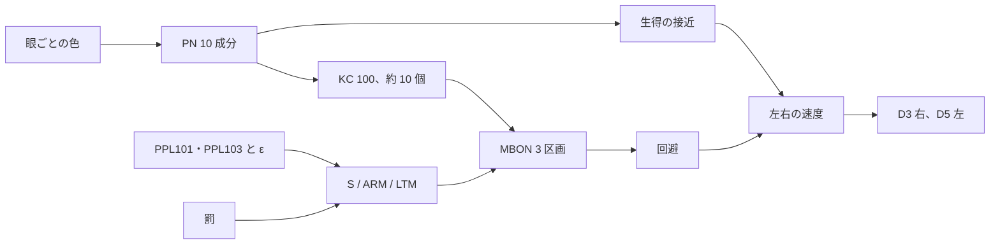

# 数理モデル

この文書は `brain/`、`sim/`、`robot/` が実際に計算しているものを式にしたものである。数値はソースの既定値で、各ブロックの末尾にファイルと関数を置く。記憶の時定数は測定値ではなく仮定である（`brain/constants.py` のモジュールコメント）。古いメモとコードが違うところはコードを採り、[末尾](#コードと古い文書)に違いをまとめた。

時間の単位は二つある。**ロボット秒**はシミュレータと実機のステップである。**生物分**は、記憶の ODE と、窓・門・疲労が使う圧縮後の時間である。

## 1. 全体像

左右の眼はそれぞれ長さ 10 の投射ニューロン（PN）ベクトルになる。ケニヨン細胞（KC）が読むのは先頭 9 成分（色相 8 ビンと明るさ）である。100 個の KC が k-winners でおよそ 10 個立ち、3 区画の MBON を押さえる。回避の強さは、その MBON を静的な重み 0.21 / 0.46 / 0.33 で足したものである。光への接近は MBON を通らない。明るさの交差結合で、右が明るければ左の車輪が速くなる。

ドーパミン振動子は PPL101（MP1）と PPL103（MV1）の 2 細胞だけである。3 区画目（α′2α2、PPL105）に対応する細胞は無く、その区画の忘却駆動は常に 0 である。振動子は車輪を直接は回さない。痕跡 S / ARM / LTM を通して MBON の重みを変え、集中学習の疲労 φ として自分の入力に戻る。



罰は、直前までの適格痕跡が立っている KC にだけ、3 区画の S を同時に足す。左右の眼は一つのキノコ体を共有し、記憶に渡す KC は両眼の要素ごとの最大である。回避の読み出しだけ眼ごとに分かれる。

出典: `brain/coding.py` `pn_code`、`brain/memory.py` `MB`、`brain/dan.py` `DAN2`、`brain/wheels.py` `wheel_speeds`、`brain/brain.py` `Brain.step`。

## 2. 変数と記号

既定値は引数を省略したときの値である。`make_brain(seed)` は振動子セットを `seed % 4` で選ぶ（`brain/brain.py` `make_brain`）。

### 時間と大きさ

| 記号 | 意味 | 単位 | 既定 | 場所 |
|---|---|---|---|---|
| \(\Delta t\) | ステップ | ロボット秒 | 0.02（50 Hz） | `TICK_S`、`Agent.drive` の `dt` |
| \(\mathrm{compression}\) | 生物分 / ロボット秒 | 生物分/s | 5 | `DEFAULT_COMPRESSION`、`config.COMPRESSION` |
| \(t\) | ロボット時刻 | ロボット秒 | 0 | `Brain.t` |
| \(t_{\mathrm{bio}}=t\cdot\mathrm{compression}\) | 生物時刻 | 生物分 | 0 | `Brain.bio_min` |
| \(n_{\mathrm{KC}}\) | KC 数 | 個 | 100 | `N_KC` |
| \(n_{\mathrm{PN}}\) | KC が読む PN 数 | 個 | 9 | `N_PN` |
| \(c\) | 1 KC の爪の本数 | 本 | 4 | `N_CLAWS` |
| \(k\) | 残す KC 数 | 個 | 10 | `K_ACTIVE` |
| 区画数 | S / A / L の行 | 個 | 3 | `N_COMPARTMENTS` |

シミュレーションの `run_job` は `DEFAULT_COMPRESSION` を使う。実機の `robot/python/config.py` の `COMPRESSION` は同じ値を読む。変えたいときは `brain/constants.py` のその定数だけを変える。

### 入力

| 記号 | 意味 | 単位 | 既定 | 場所 |
|---|---|---|---|---|
| 色相ビン | 8 ビンの中心 | 度 | \(0,45,\ldots,315\) | `HUES` |
| \(\sigma_h\) | 色相ガウスの幅 | 度 | 30 | `HUE_SIGMA` |
| CS+ / CS− | 条件付けの色相 | 度 | 0（赤、罰）/ 240（青、安全） | `CS_PLUS_HUE`、`CS_MINUS_HUE` |
| \(p\in\mathbb{R}^{10}\) | 1 眼の PN | 混合 | — | `pn_code` |
| 床 | これ未満は KC なし | 明るさ | 0.03 | `KC_FLOOR` |
| カメラ更新 | 眼の読み直し | ロボット秒 | 0.10 | `COUNT_S` |
| `COLOR_GAIN` | 画素割合の倍率 | 無次元 | 1 | `config.COLOR_GAIN` |

\(p_0,\ldots,p_7\) が色相、\(p_8\) がランプ重みの合計（明るさ）、\(p_9=\sqrt{p_8}\) である。\(p_9\) は KC も車輪も読まない。`coding.py` は、古い軌跡と桁を揃えるために残してある、と書いている。

### 読み出しと罰

| 記号 | 意味 | 単位 | 既定 | 場所 |
|---|---|---|---|---|
| \(g\) | 区画の回避重み | 無次元 | \((0.21,\ 0.46,\ 0.33)\) | `GAINS` |
| \(\delta\) | KC→MBON の抑圧 | 無次元 | 0.8 | `MEMORY["delta"]` |
| \(\eta_p\) | 罰 1 回の増分 | 無次元 | 0.13 | `MEMORY["eta_p"]` |
| \(\tau_e\) | 適格痕跡 | ロボット秒 | 2 | `MEMORY["tau_e"]` |
| 不応期 | 罰の最短間隔 | ロボット秒 | 1 | `SHOCK_REFRACTORY_S` |
| \(u_{\mathrm{ext}}\) の初期 | 罰パルスの高さ | 無次元 | 1.5 | `SHOCK_DRIVE` |
| 罰の減衰 | \(u_{\mathrm{ext}}\) の傾き | 1/ロボット秒 | 5 | `SHOCK_DECAY` |

\(g\) は float32 で、和は 1 になる。対応は γ1pedc ← PPL101、γ2α′1 ← PPL103、α′2α2 ← PPL105（`constants.py` のコメント）。

### 振動子

| 記号 | 意味 | 単位 | 既定 | 場所 |
|---|---|---|---|---|
| \(D_i, a_i\) | 細胞 \(i\) の活動と順応 | 無次元 | 下記 | `DAN2.D`、`DAN2.a` |
| \(\tau\) | \(D\) の時定数 | ロボット秒 | 0.1 | `DAN2` の `tau` |
| \(\varepsilon\) | 拡散結合 | 無次元 | 0.1 | `Brain` の `eps` |
| \(o\) | 疲労からのバイアス | 無次元 | \(-0.5\,\varphi\) | `Brain._signals` |
| \(\mathrm{het}\) | 2 細胞をずらす | — | 真 | `DAN2` |

細胞 0 が PPL101、細胞 1 が PPL103 である。`DAN2` を単体で作ると \(D=(4,\ 1.2)\)、\(a=(1,\ 1)\) から始まる。`Brain` はこれを上書きし、\(D_0=4\)、\(D_1=1+U\)、\(U\) は `default_rng(seed)` の最初の一様乱数で \([1,2)\) に入る（`Brain.__init__`）。

セット \((g_s,\ g_a,\ \tau_a,\ D_{\max})\) と、ドーパミンを割る定数は `brain/sets.py` の `OSC_SETS` と `NORMS` である。\(\tau_a\) の単位はロボット秒、\(D_{\max}\) は \(\mathrm{logi}\) の上限である。

| seed % 4 | \(g_s\) | \(g_a\) | \(\tau_a\) | \(D_{\max}\) | A101 | A103 | ADD | COI |
|---|---|---|---|---|---|---|---|---|
| 0 | 1.6 | 1.4 | 2.5 | 9 | 2.78068 | 2.895865 | 2.838273 | 20.976257 |
| 1 | 1.2 | 1.4 | 2.5 | 5 | 0.886499 | 0.922809 | 0.904654 | 2.88495 |
| 2 | 1.2 | 1.0 | 2.5 | 9 | 2.30319 | 2.407926 | 2.355558 | 17.27002 |
| 3 | 2.0 | 1.4 | 4.0 | 5 | 1.6632 | 1.719906 | 1.691553 | 6.283312 |

`sets.py` は、この NORMS を「\(\varepsilon=0.1\)、100 s の助走のあと 200 s の自由走行の平均」と書いている。再計算はしていない。

### 記憶（率は生物分あたり）

| 記号 | 役割 | 既定 | 場所 |
|---|---|---|---|
| \(k_S\) | S の受動減衰 | \(1/60\) | `MEMORY["kS"]` |
| \(k_F\) | ドーパミン忘却 | \(1/60\) | `kF` |
| \(k_A\) | S→ARM | \(1/30\) | `kA` |
| \(\theta_z\) | 一致の半飽和 | 0.5 | `th` |
| \(\theta_L\) | LTM による ARM の抑制 | 0.2 | `thL` |
| \(k_{Ad}\) | ARM 減衰。時定数 48 h | \(1/(48\cdot 60)\) | `kAd` |
| \(k_L\) | LTM の書き込み | \(1/5\) | `kL` |
| \(k_E\) | 間隔後の ARM 消去 | \(1/5\) | `kE` |
| \(k_{Ld}\) | LTM 減衰。時定数 7 日 | \(1/(7\cdot 24\cdot 60)\) | `kLd` |
| \(\tau_z\) | 一致の遅いフィルタ | 30 生物分 | `tau_z` |
| 窓、門 | LTM 窓の長さと開く隙間 | 各 10 生物分 | `win`、`gate` |
| 消去の長さ | ARM を消す時間 | 15 生物分 | `MB.end_cycle` の数値リテラル |
| \(\tau_\varphi\) | 疲労の減衰 | \(24\cdot 60\) 生物分 | `tau_phi` |

S、A、L は形 \((3,\ 100)\) の float32 である。行が区画、列が KC である。

### 車輪と車体

| 記号 | 意味 | 単位 | コードが積分に使う値 | 実機の計測 | 場所 |
|---|---|---|---|---|---|
| \(v_{\max}\) | 指令の上限 | m/s | 0.06 | — | `VMAX` |
| \(b_w\) | 暗いときのバイアス | 無次元 | 0.35 | — | `WHEEL_BIAS` |
| \(k_{\mathrm{app}}\) | 接近 | 無次元 | 1 | — | `WHEEL_APPROACH` |
| \(k_{\mathrm{av}}\) | 回避 | 無次元 | 2.5 | — | `WHEEL_AVOID` |
| 車幅 | 左右駆動輪の間隔 | m | 0.12（`TRACK`） | 0.0975（後輪） | `TRACK`、`CHASSIS_REAR_TRACK_M` |
| \(L\) | 後車軸から前車軸 | m | 積分は使わない | 0.08 | `CHASSIS_WHEELBASE_M` |

`TRACK` は fly-car の車輪間隔で、`sim/arena.py` の `Agent.drive` が角速度をこれで割る。実機の 9.75 cm と 8.0 cm は `CHASSIS_REAR_TRACK_M` と `CHASSIS_WHEELBASE_M` に名前だけがある。`robot/python/config.py` は同じ値を `REAR_TRACK_M`、`WHEELBASE_M` として再エクスポートする。どちらもパルス変換にもアリーナの積分にも入らない。

## 3. 各サブモデル

### 3.1 入力の符号化

空のシーンは零ベクトルである。ランプ \(i\) の重み \(w_i\) と色相 \(h_i\)（度）から、ビン中心 \(q\cdot 45^\circ\) への円周距離を

$$
\delta(h, q) = \big|\big((q\cdot 45 - h + 180) \bmod 360\big) - 180\big|
$$

とし、

$$
b_q = \sum_i w_i \exp\big(-\delta(h_i, q)^2 / (2\sigma_h^2)\big), \quad
p = \big(b_0,\ldots,b_7,\ \textstyle\sum_i w_i,\ \sqrt{\sum_i w_i}\big)
$$

である。\(\sigma_h=30\)。出典: `pn_code`。

アリーナの眼は、この前段が角度ゲートである。頭の向きを 0 として、左眼の窓は \([-12^\circ,\ +40^\circ]\)、右眼は \([-40^\circ,\ +12^\circ]\) である。ランプまで \(d\)（m）、相対角 \(\psi\)（度）のとき、見かけの半幅 \(\alpha=\mathrm{atan2}(0.05,\ \max(d, 10^{-6}))\) を度にしたもので

$$
G = \sigma\big((\psi-\psi_{\mathrm{lo}}+\alpha)/3\big)\ \sigma\big(-(\psi-\psi_{\mathrm{hi}}-\alpha)/3\big)
$$

$$
w = \frac{G}{1+(d/0.3)^2}\,(1 + 0.05\,\xi), \quad \xi\sim\mathcal{N}(0,1)
$$

\(\sigma(x)=1/(1+e^{-x})\) である。負の \(w\) は 0 に切ってから `pn_code` に渡す。0.05 m は見かけの半幅（ランプ幅 10 cm）、0.3 m は明るさの距離スケール、3° は窓の縁の柔らかさである。出典: `sim/arena.py` `eye_intensity`。

実機の眼は画素である。数え方は fly-car の `occupancy.color_masks` と同じである。OpenCV の HSV を使い、色相は OpenCV の値を 2 倍して度にする。閾値は `color_thresholds.json` で、赤は \((\mathrm{hue}\le\mathrm{hue\_low})\lor(\mathrm{hue}\ge\mathrm{hue\_wrap})\)、青は閉区間である。既定は fly-car がこのカメラで合わせた値で、赤は彩度 100・明度 120・\(\mathrm{hue\_low}=-1\)・\(\mathrm{hue\_wrap}=322\)（低域は無く、322° 以上。色紙は 340° 付近）、青は彩度 160・明度 70・180° から 220°。フレームの 0.2% 未満の連結領域は捨て（`REGION_MIN_FRACTION`）、幅が 320 を超えるフレームは数える前に幅 320 へ縮める。左眼は列中心 \((i+0.5)/W\le 0.65\)、右眼は \(\ge 0.35\) で、中央は両眼に入る。眼の割合が `fraction_floor`（既定 0.05）未満のときはログに残し、PN には渡さない。渡す重みは \(\mathrm{COLOR\_GAIN}\cdot f\)、色相は測った色ではなく 0° と 240° の固定値である。出典: `robot/python/colors.py`。

### 3.2 KC と k-winners

\(p_8 < 0.03\) なら KC は全零、顕著性 \(s=0\) で返る。それ以外は添字 0 から 8 を明るさで割る。

$$
c_i = p_i / p_8, \quad i = 0,\ldots,8
$$

\(c_8 = 1\) なので、読む 9 成分の最後は定数 1 である。色相ビンの和は 1 にはならない。ガウスが隣のビンにも乗るためである。KC \(j\) の爪 \(I_{j,1},\ldots,I_{j,4}\) は \(\{0,\ldots,8\}\) から重複なしに一度だけ引き、固定する（乱数は `seed+1000`）。

$$
h_j = \sum_{m=1}^{4} c_{I_{j,m}} + 10^{-4}\,\xi_j
$$

\(\xi_j\) は \([0,1)\) の一様乱数である。しきい値 \(\theta\) は \(h\) の大きい方から \(k=10\) 番目で、\(h_j \ge \theta\) を 1、残りを 0 にする。同点はすべて残るので、活動数は 10 を超え得る。\(\xi_j\) がその同点をほぼ割る。顕著性は

$$
s = \min(1,\ p_8 / 0.5)
$$

である。出典: `MB.kenyon`。

### 3.3 KC→MBON の重みと、罰でゲートする可塑性

重みは独立した状態ではない。痕跡から毎回計算する。

$$
w_{c,j} = 1 - \delta \min(1,\ S_{c,j}+A_{c,j}+L_{c,j}), \quad \delta=0.8
$$

活動 KC の平均が MBON で、誰も立っていなければ 1（抑圧なし）である。

$$
m_c = \begin{cases} 1 & \sum_j k_j = 0 \\ \sum_j w_{c,j} k_j \big/ \sum_j k_j & \text{それ以外} \end{cases}
$$

$$
y = s \sum_{c=0}^{2} g_c (1-m_c)
$$

\(y\) が大きいほど、その眼の側を避ける。振動子の順応 \(a_i\) とは別の量である。出典: `MB.mbon`、`MB.avoid`。

適格痕跡 \(e\in\mathbb{R}^{100}\) は KC の一次遅れで、ロボット秒で進む。両眼の KC を \(k^{\mathrm{L}}, k^{\mathrm{R}}\) として \(k=\max(k^{\mathrm{L}}, k^{\mathrm{R}})\)（要素ごと）とし、

$$
e \leftarrow e + \frac{\Delta t}{\tau_e}(k-e), \quad \tau_e = 2
$$

である。罰の 1 回は、学習がオンのとき全区画に

$$
S \leftarrow S + \eta_p\, e\,(1-S), \quad \eta_p=0.13
$$

を足す。\(\Delta t\) は掛からない。学習オフでもショック回数は増えるが、S は変わらない。出典: `MB.us`、`MB.step_mem` の先頭。

同じ `integrate` の中では、罰が古い \(e\) を使ったあとで、今の KC が \(e\) を更新する。今フレームで初めて立った KC は、そのステップの罰には間に合わない（`Brain.integrate` の docstring）。

不応期はロボット秒で 1 である。期間内の要求は捨て、次のステップへ持ち越さない（`Brain.punish`）。通った要求は \(u_{\mathrm{ext}}\leftarrow 1.5\) とし、その後の毎ステップで

$$
u_{\mathrm{ext}} \leftarrow \max(0,\ u_{\mathrm{ext}} - 5\,\Delta t)
$$

と直線的に落とす。高さ 1.5 なので 0.3 ロボット秒で 0 になる。指数減衰ではない。出典: `Brain._signals`。

アリーナはバー接触でも同じ `request_shock` を呼ぶ。接触の要求自体にも 1 秒の間隔がある（`Agent.drive`）。

### 3.4 PPL1 の 2 細胞と ε

`dan.py` の連続式は次である。\(\tau=0.1\) ロボット秒。

$$
\tau \dot D = -D + \mathrm{logi}\big(1 + o + u_{\mathrm{ext}} + g_s(D-1) - g_a(a-1) + \varepsilon(D_{\mathrm{other}}-D)\big)
$$

$$
\tau_a \dot a = -a + D
$$

飽和は、\(\mathrm{logi}(1,\ D_{\max})=1\) になるようにずらしたロジスティックである。

$$
s = 1 - 1/D_{\max}, \quad
c = 1 + s \ln(D_{\max}-1)
$$

$$
\mathrm{logi}(x,\ D_{\max}) = \frac{D_{\max}}{1+\exp\big(-(x-c)/s\big)}
$$

\(\mathrm{het}\) が真（既定）のとき、細胞 0 は \((g_s,\ g_a,\ \tau_a)\) のまま、細胞 1 は \(g_a\) を 0.95 倍、\(\tau_a\) を 1.1 倍する。\(g_s\) は両細胞で同じである。

実装は陽的 Euler で、\(D\) は更新のあと float32 に戻す。順応は古い \(D\) で先に更新する。

$$
u_i = 1 + o + u_{\mathrm{ext}} + g_{s,i}(D_i-1) - g_{a,i}(a_i-1) + \varepsilon(D_{1-i}-D_i)
$$

$$
a_i \leftarrow a_i + \frac{\Delta t}{\tau_{a,i}}(D_i - a_i)
$$

$$
D_i \leftarrow D_i + \frac{\Delta t}{\tau}\big(\mathrm{logi}(u_i,\ D_{\max}) - D_i\big)
$$

ギャップ項は更新前の \(D\) だけで組む。`osc=False` は \(g_s\) と \(g_a\) の項だけを 0 にし、\(\varepsilon\) は残す。出典: `DAN2.step`、`logi`。

\(\varepsilon\) は MP1–MV1 ギャップ結合の作業仮説である。対記録も、色素結合も、イネキシンの結果も無い、と `dan.py` と `docs/SUMMARY.md` が書いている。

疲労は \(\varphi\in[0,1]\) で、振動子への加算は \(o=-0.5\,\varphi\) だけである。短い隙間が \(\varphi\) を 1 にし、その後は

$$
\varphi \leftarrow \varphi \exp(-\Delta t_{\mathrm{bio}} / \tau_\varphi)
$$

と減衰する。これは線形 ODE の厳密解で、S / A / L の陽的 Euler とは違う。\(\varphi=1\) はデータから導いた状態ではなく、外から置いている（`memory.py` のモジュールコメント）。

ドーパミンから記憶への信号は、1 を超えた分だけである。\(r_i=\max(D_i-1,\ 0)\) として

$$
F = \big(r_0/N_{101},\ r_1/N_{103},\ 0\big)
$$

既定の COI では一致が積、`variant="ADD"` では平均である。

$$
Z_{\mathrm{COI}} = r_0 r_1 / N_{\mathrm{COI}}, \quad
Z_{\mathrm{ADD}} = (r_0+r_1) / (2\,N_{\mathrm{ADD}})
$$

\(N\) は上の表の、そのセットの NORMS である。3 区画目の \(F\) は常に 0 なので、PPL105 の区画は進行中のドーパミンでは忘れない。出典: `MB.signals`。`Brain` の既定 variant は `"COI"` で、`python -m sim` はこれを変えない。

`sets.py` は、採用の目安を「周期およそ 5–15 ロボット秒、\(\varepsilon=0.1\) で相関およそ 0.95、\(\varepsilon=0\) で相関およそ 0、一致の比およそ 0.3」と書いている。周期そのものは定数になっていない。`DAN2` の既定初期値 \((D,a)=((4,1.2),(1,1))\)、\(\Delta t=0.02\)、150 s のうち最初の 30 s を捨て、\(D_0\) から平均を引いた上昇零交差で測ると、セット 0 から 3 の周期は 10.16、5.37、9.82、15.77 s（交差間隔の標準偏差は 0.01 s 前後）、同時の相関は 0.940、0.962、0.966、0.941 であった。セット 3 は「およそ 15 s」の外側に少し出る。同じ積分でセット 0 を \(\varepsilon=0\) にすると、助走 20 s のあと 60 s の相関は \(-0.15\) であった。テストが固定しているのは、セット 0 について \(\varepsilon=0.1\) で相関が 0.8 より大きいことと、\(\varepsilon=0\) で 0.3 より小さいことだけである（`tests/test_brain.py`）。

### 3.5 記憶の固定。ARM と LTM

生物時間のステップは \(\Delta t_{\mathrm{bio}}=\mathrm{compression}\cdot\Delta t_{\mathrm{robot}}\) である。遅い一致 \(z\) はスカラーで、

$$
z \leftarrow z + \frac{\Delta t_{\mathrm{bio}}}{\tau_z}(Z-z), \quad \tau_z=30
$$

S から ARM への流れは、区画 \(c\) ごとに

$$
C_c = \frac{k_A S_c}{(1+z/\theta_z)\,(1+\bar L_c/\theta_L)}
$$

\(\bar L_c\) はその区画の KC 平均である。\(z\) が大きいと ARM へ移りにくく、LTM が溜まっても移りにくい。

$$
\dot S_c = -(k_S + k_F F_c)\,S_c - C_c
$$

$$
\dot A_c = C_c - k_{Ad} A_c - E_c
$$

$$
E_c = \begin{cases} k_E\, z\, A_c & t_{\mathrm{bio}} < t_{\mathrm{erase}} \\ 0 & \text{それ以外} \end{cases}
$$

$$
\dot L_c = W_c - k_{Ld} L_c
$$

$$
W_c = \begin{cases} k_L\, S_c\, \dfrac{Z}{Z+\theta_z} & t_{\mathrm{bio}} < t_{\mathrm{win}} \\ 0 & \text{それ以外} \end{cases}
$$

LTM の書き込みは遅い \(z\) ではなく、そのステップの瞬間の \(Z\) を使う。ARM の変換と消去は \(z\) を使う。

積分は陽的 Euler で、訓練中だけ S の扱いが変わる。`in_train` のとき S から引くのは \(C\) だけで、\(k_S\) と \(k_F\) の減衰は止める。A と L は訓練中も通常どおり進む。

$$
S \leftarrow \begin{cases} S - \Delta t_{\mathrm{bio}}\, C & \text{訓練中} \\ S + \Delta t_{\mathrm{bio}}\, \dot S & \text{それ以外} \end{cases}
$$

$$
A \leftarrow A + \Delta t_{\mathrm{bio}}\,\dot A, \quad L \leftarrow L + \Delta t_{\mathrm{bio}}\,\dot L
$$

跡は \([0,1]\) へ射影しない。飽和は罰の \((1-S)\) と、読み出しの \(\min(1, S+A+L)\) だけである。出典: `MB.step_mem`。

周の終わりは生物分で渡す。隙間は「この周の開始」と「直前の周の終了」の差で、最初の周に隙間は無い（`MB.end_cycle`）。

- 隙間が 10 生物分以上なら、\(t_{\mathrm{win}}=t_{\mathrm{end}}+10\)、\(t_{\mathrm{erase}}=t_{\mathrm{end}}+15\)。LTM を書くのは、その周が終わったあとの 10 生物分である。ARM の消去は同じ終了時刻から 15 生物分で、数値 15 は `MEMORY` に入っていない。
- 隙間が 10 未満なら \(\varphi\leftarrow 1\)。窓は開かない。
- 最初の周はどちらもしない。

分散のシミュレーションは隙間 15 ロボット秒で、圧縮 1 では 15 生物分である。2 周目以降の終わりに窓が開き、続く休息 15 生物分のうち最初の 10 分で LTM が書き込まれる。消去の 15 分はその休息全体と重なる。最終周のあとには休息が無いので、消去と窓は保持期間の先頭 15 分と 10 分に入り込む。集中は隙間 2 秒で門を下回り、\(\varphi=1\) だけで窓は開かない。

`docs/behavior/xbehav.py` は別のゲートである。あちらは「これから来る休息が 10 分以上なら、その休息の最初の 10 分」に LTM を書き、ARM を消す。最初の休息でも書き、最終周のあとの保持期間では消さない。\(k_L\) も \(1/20\) で、コードの \(1/5\) の 4 分の 1 である。`constants.py` はこの二つ（\(k_L\) と因果的な門）を変更点として書いている。罰の粒はさらに違う。xbehav は周に 1 回、区画ベクトル全体へ \(\eta=0.5\) を足す。コードはショックごとに、適格な KC へ \(\eta_p=0.13\) を足す。

### 3.6 ステップの中の順序

`Brain.step` は `sense` のあと `integrate` する。

1. `sense` は今の PN から KC、回避、車輪速度を計算する。時刻も \(e\) も進まない。
2. 罰が待っていれば `punish`。不応期を過ぎていれば S を更新し、\(u_{\mathrm{ext}}=1.5\)。
3. \(o=-0.5\varphi\) を置いて `DAN2.step`。続けて \(u_{\mathrm{ext}}\) を減衰させる。
4. \(F\) と \(Z\) を計算し、\(e\)、\(z\)、S、A、L、\(\varphi\) の順に更新する。
5. 最後に \(t\leftarrow t+\Delta t\)。窓との比較に使う生物時刻は、この加算の前の値である。

出典: `Brain.sense`、`Brain.integrate`、`Brain._signals`。

## 4. 時間圧縮と積分

記憶の ODE、窓、門、\(\varphi\) は \(\Delta t_{\mathrm{bio}}=\mathrm{compression}\cdot\Delta t\) で進む。振動子には同じ倍率を掛けた原生時間を渡すので、\(\tau\) と \(\tau_a\) は生物時間では圧縮 1 のままである。適格痕跡は \(\Delta t_{\mathrm{bio}}/\tau_e\)（\(\tau_e=2\) 生物分）。罰の減衰と不応期も生物時間で一定になるよう、ロボット秒の側を圧縮で割る。車輪の m/s はロボットの実速度のままで、アリーナだけが圧縮 1 の歩幅を保つ。

50 Hz の一歩で生物時間が 0.02 分を超えるときは、`Brain.integrate` がその刻みまで割る。圧縮 5 の 0.02 ロボット秒は生物 0.10 分なので 5 片になり、各片の \(h/\tau\) は 0.2 で、圧縮 1 の陽的 Euler と同じ安定条件である。圧縮 1 では片は 1 つで、割る前の更新と一致する。

振動の 1 周（およそ 5–16 生物分）は、圧縮 5 ではおよそ 1–3.2 ロボット秒に見える。生物時間の周期は圧縮しない。

| 生物時間 | 圧縮 1 のロボット時間 | 圧縮 5 |
|---|---|---|
| 1 分 | 1 秒 | 0.2 秒 |
| 1 時間 | 1 分 | 12 秒 |
| 24 時間 | 24 分 | 4.8 分 |
| 72 時間 | 72 分 | 14.4 分 |

停車中の `Brain.idle` は、生物 0.4 分（圧縮 1 ならロボット 0.4 秒）を 1 ブロックにする。中では振動子を原生 \(\Delta t=0.02\) で `sub=20` 回進め、\(F\) と \(Z\) を平均し、記憶はブロック長の Euler を 1 回だけ取る。ロボット時間のブロックは 0.4/compression 秒である。KC は零を渡すので、\(e\) は休息で落ちる。\(u_{\mathrm{ext}}\) の減衰は細かいステップの側で行う。出典: `Brain.idle`。

実機のループは、カメラを 0.10 秒ごと、脳を 0.02 秒ごとに進める。遅れは最大 0.70 秒（35 ステップ）まで同じフレームで追いつく（`main.run`）。訓練フラグは「周が開いているあいだ」で、シミュレーションが 20 秒の走行にだけ `in_train=True` を付けるのとは、囲いが違う。

## 5. 行動と運動

### 5.1 MBON から左右の指令

眼の明るさと回避を、それぞれ 1 で頭打ちにする。\(B=\min(1,\ 2 p_8)\)、\(\alpha=\min(1,\ y)\)。\(y\) は 3.3 の回避駆動である。\(B\) は KC の顕著性 \(s=\min(1,\ p_8/0.5)\) と同じ式である。ただし \(p_8<0.03\) のとき KC 側は \(s=0\) で回避が消える一方、車輪の \(B\) は \(p_8\) をそのまま使う。床は KC にだけ掛かる。

回避の生の項は、同側を速くし反対側をその半分だけ遅くする。その対の共通成分は前進なので、左右が同じ回避だと両方の車輪が全速で前に出る。その共通成分は引いて、平均の回避に比例する後退を両輪から引く。左右の差が小さい強い回避では、さらに保持した旋回 \(s\in\{-1,0,+1\}\) を足す。\(s=+1\) は右輪を速くする（fly-car の正のヨー、左へ曲がる）。

$$
r_L = k_{\mathrm{av}}\alpha_L - 0.5\,k_{\mathrm{av}}\alpha_R, \quad
r_R = k_{\mathrm{av}}\alpha_R - 0.5\,k_{\mathrm{av}}\alpha_L
$$

$$
c = (r_L+r_R)/2, \quad
\rho = k_{\mathrm{ret}}\,(\alpha_L+\alpha_R)/2
$$

$$
u_L = b_w + k_{\mathrm{app}} B_R (1-\alpha_R) + (r_L - c) - \rho - k_{\mathrm{spin}} s
$$

$$
u_R = b_w + k_{\mathrm{app}} B_L (1-\alpha_L) + (r_R - c) - \rho + k_{\mathrm{spin}} s
$$

$$
v_L = \mathrm{clip}(u_L,\ -1,\ 1)\,v_{\max}, \quad
v_R = \mathrm{clip}(u_R,\ -1,\ 1)\,v_{\max}
$$

\(b_w=0.35\)、\(k_{\mathrm{app}}=1\)、\(k_{\mathrm{av}}=2.5\)、\(k_{\mathrm{ret}}=1.25\)、\(k_{\mathrm{spin}}=0.7\)、\(v_{\max}=0.06\,\mathrm{m/s}\) である。右が明るいと左が速くなり、光の方へ曲がる。回避が片側だけ強いと、その側の車輪が速くなり、色からそれる。左右が揃って強いと前進が落ち、後退しながら曲がる。出典: `wheel_speeds`、`update_avoid_spin`。`DESIGN.md` が書く \(b=0.35\)、\(k_A=1\)、\(k_V=2.5\) は、この \(b_w\)、\(k_{\mathrm{app}}\)、\(k_{\mathrm{av}}\) である。記憶の \(k_A=1/30\) とは別の記号である。\(s\) は平均回避が 0.35 未満なら 0。差の絶対値が 0.25 以上なら微分の旋回に任せ、符号だけ覚える。それより狭いあいだは、覚えた符号を出し続ける。最初の選択は +1。

シミュレーションは \(b_w=0.35\) のままである。暗いときの指令は \(0.35\times 0.06=0.021\,\mathrm{m/s}\) で、パルスにすると 17 になり、前進の不感帯 13 より上に残る。実機はこの項を渡さない。`robot/python/config.py` の `EXPLORE_BIAS` が `wheel_speeds` の `bias` で、既定は 0 である。fly-car にも、ターゲットが無いときの基準駆動は無い。0 にすると色が無いときの指令は 0 である。0.35 に戻すと、上のパルス 17 の前進が戻る。探索のためのつまみであり、既定では切ってある。

実機は、さらに、指令の絶対値が前進不感帯の速度（\(13\times 0.20/160=0.01625\,\mathrm{m/s}\)）未満の車輪を 0 にし、パルスも 0 にする。負の微小値を後退シフト 36 に掛けないためでもある。ログの `drive` は、残った指令を作った項（`explore` / `approach` / `avoid`、どれも無ければ `none`）である。`COLOR_GAIN` が 1 のとき、眼の約 0.14 未満は不感帯の下に残り、車輪は出ない。小さいパネルを動かしたいときは `COLOR_GAIN` を上げる。

### 5.2 差動二輪の運動学

シミュレータは、ノイズを足したあとの車輪速度でユニサイクルを陽的 Euler 積分する。車幅は `TRACK` \(=0.12\,\mathrm{m}\) である。

$$
v = (v_R+v_L)/2, \quad \omega = (v_R-v_L)/0.12
$$

$$
x \leftarrow x + \Delta t\, v\cos\theta, \quad
y \leftarrow y + \Delta t\, v\sin\theta, \quad
\theta \leftarrow \theta + \Delta t\,\omega
$$

\(\theta=0\) が \(+x\)、正の \(\omega\) が反時計回りである。右が速いと左へ曲がる。円弧の厳密解（\(\sin(\omega\Delta t)/\omega\)）ではなく、上の Euler である。位置は車軸を区別しない一点で、初期値は \((0,\ -0.3)\)、向きは \(\pi/2\) である。出典: `Agent.drive`。

ノイズは車輪ごとで、積分の前に足し、\(v_{\max}\) では切り直さない。

$$
\eta \leftarrow \eta + \frac{\Delta t}{0.5}(-\eta) + 0.25\,v_{\max}\sqrt{2\Delta t/0.5}\,\xi
$$

\(\xi\) は標準正規の 2 ベクトルである。これは時定数 0.5 ロボット秒、定常標準偏差 \(0.25\,v_{\max}=0.015\,\mathrm{m/s}\) の Ornstein–Uhlenbeck 過程の Euler–Maruyama 更新になっている。実機のループにこのノイズは無い。

壁は位置をアリーナ \([-1/2,\ 1/2]^2\) に切るだけで、向きは反射しない。訓練のバーは \((0,\ 0.38)\) で、新しい \(y\) が 0.38 を超え、\(|x|<0.15\) なら \(y\) を 0.38 に戻して罰を要求する。ランプの \(y\) は 0.35 なので、バーはランプの 3 cm 向こうにある。

旋回半径は \(\omega\neq 0\) のとき \(R=v/\omega\) である。`TRACK` を使ったシミュレーションでは

$$
R = \frac{0.12}{2}\cdot\frac{v_R+v_L}{v_R-v_L}
$$

同じ符号で、瞬間中心は \((x-R\sin\theta,\ y+R\cos\theta)\) に置ける。コードはこの点を計算しない。

### 5.3 実機の車体

計測した車体は、後輪間隔 \(b=9.75\,\mathrm{cm}=0.0975\,\mathrm{m}\)、ホイールベース \(L=8.0\,\mathrm{cm}=0.08\,\mathrm{m}\) である。積分は 0.12 m のままである。測った後輪間隔で 5.2 と同じ式を書き直すと

$$
v = (v_R+v_L)/2, \quad \omega = (v_R-v_L)/b
$$

$$
R = \frac{v}{\omega} = \frac{b}{2}\cdot\frac{v_R+v_L}{v_R-v_L}
$$

姿勢の更新は 5.2 と同じ Euler である。\(L\) は \(v\) にも \(\omega\) にも入らない。後車軸の中点を \((x,y)\) とみなすなら、前車軸は \(L(\cos\theta,\ \sin\theta)\) だけ前にあり、同じ瞬間中心までの距離は \(\sqrt{R^2+L^2}\) である。この前車軸はコードのどこにも無い。`DESIGN.md` の「車輪間隔 0.12 m」は fly-car の値で、`TRACK` と一致する。9.75 cm はそこには出てこない。

### 5.4 パルスとピン

速度からスケッチの指令 \(-255,\ldots,255\) へは、

$$
q = \mathrm{clip}\big(\mathrm{round}(v\cdot 160/0.20),\ -255,\ 255\big)
$$

前進は \(0\le q<13\) を 0 にし、13 以上はそのままである。後退は不感帯で捨てるのではなく、\(q-36\) を \(-255\) で頭打ちにする。\(v_{\max}=0.06\) は \(q=48\) になる。戻り値の順は `(右, 左)` で、`setMotorSpeed(right, left)` に渡る。出典: `robot/python/pulse.py` `wheel_pulses`。

スケッチは右を D3、左を D5 に出す。両輪とも

$$
T = \mathrm{clip}(1500 + q/255\cdot 500,\ 1000,\ 2000)\ \mu\mathrm{s}
$$

である。左の正負は配線が逆なので、ソフトウェアは左を反転しない。正の \(q\) が両輪の前進になる（`robot/sketch/motors.cpp`）。3 秒指令が途切れるとウォッチドッグが止める。

## 6. 計算コスト

`brain/budget.py` の `flop_budget` は、逆アセンブルではなくデータの形からの勘定である。\(n_{\mathrm{KC}}=100\)、爪 4、区画 3 では

$$
\begin{aligned}
N_{\mathrm{pn}} &= 2\cdot(8\cdot 3\cdot 6) = 288 \\
N_{\mathrm{kc}} &= 2\cdot(n_{\mathrm{KC}}\cdot 4 + 3\,n_{\mathrm{KC}}) = 1400 \\
N_{\mathrm{mbon}} &= 2\cdot(3\cdot n_{\mathrm{KC}}\cdot 3) = 1800 \\
N_{\mathrm{dan}} &= 2\cdot 20 = 40 \\
N_{\mathrm{mem}} &= 3\cdot n_{\mathrm{KC}}\cdot 20 = 6000 \\
N_{\mathrm{motor}} &= 30
\end{aligned}
$$

合計は **9558 flop / ステップ** である。50 Hz では \(9558\times 50 = 477900\) flop/s。160 MHz を 1 flop/cycle、SIMD なしと置くと \(477900/(1.6\times 10^{8}) = 0.2987\%\) である。`docs/results/cost.txt` は同じ 9558 を書き、0.48 MFLOP/s・0.30% と丸めている。README と `DESIGN.md` の「約 9600 flop」はその丸めである。cost.txt の「別マシンで約 140 µs」は、この作業では測り直していない。

状態の予算 `mcu_state_bytes` は

$$
100\cdot 4 + 3\cdot 100\cdot 3\cdot 4 + 100\cdot 4 + 6\cdot 4 + 64 = 4488\ \mathrm{B}
$$

内訳は、爪の uint8 が 400 B、S/A/L が 3600 B、適格痕跡が 400 B、DAN 用の 24 B、端数 64 B である。生きた `Brain.state_nbytes` は S、A、L、適格痕跡、爪、\(D\)、\(a\) だけで **4416 B** である。テストは「予算から端数 64 B と DAN 用 24 B を除き、\(D\) と \(a\) の 16 B を足すと一致する」と固定している。jitter の 400 B、\(z\)、\(\varphi\)、窓の時刻はこのどちらにも入っていない。

## 7. 結果の再現

依存を入れてから、次が README の再実行である。

```bash
python3 -m pip install -r requirements.txt
python3 -m pytest
python3 -m sim
```

`python3 -m sim` の既定は種子 4、試行 12、ワーカ 4、条件は集中と分散のそれぞれ野生型・\(\varepsilon=0\)・振動子オフである。1 回訓練、学習オフ、ADD はコードにあるが、この既定には入らない（`sim/experiment.py` の `DEFAULT_CONDITIONS`）。圧縮は `DEFAULT_COMPRESSION`（標準 5）である。

プロトコルは `PROTOCOLS` で、集中が 5 周・隙間 2 ロボット秒、分散が 5 周・隙間 15 ロボット秒である。各周は CS+（バーあり）20 秒、CS−（バーなし）20 秒で、そのあと `end_cycle` を呼ぶ。保持テストは未学習、および訓練後 60 / 180 / 1440 / 4320 ロボット秒で、ラベルは 1 h / 3 h / 24 h / 72 h である。テストは親の脳を `deepcopy` し、CS+ の側を試行ごとに入れ替える。親の痕跡と時計はテストでは進まない。クローンの上では最大 45 秒の `integrate` が走るので、1 試行の途中ではクローンの記憶だけが進む。選択はランプの 0.12 m 以内に入ったときで、PI は

$$
\mathrm{PI} = 100\cdot\frac{n_{-}-n_{+}}{\max(1,\ n_{-}+n_{+})}
$$

正が CS+ を避ける。分母に無選択は入らない。表の 1 マスは、種子ごとの PI の平均である。出典: `sim/experiment.py`、`sim/__main__.py`。

この作業環境での既定実行（56.0 s）が印字した表は次である。ARM72 と LTM72 は 72 時間の、CS+ に応答する KC 上の平均である。

| 条件 | naive | 1h | 3h | 24h | 72h | ARM72 | LTM72 |
|---|---:|---:|---:|---:|---:|---:|---:|
| 集中 WT | 0.0 | 100.0 | 100.0 | 82.6 | 50.0 | 0.103 | 0.000 |
| 集中 εなし | 0.0 | 100.0 | 100.0 | 82.6 | 50.0 | 0.106 | 0.000 |
| 集中 振動子オフ | 0.0 | 100.0 | 100.0 | 82.6 | 50.0 | 0.110 | 0.000 |
| 分散 WT | 0.0 | 95.5 | 95.8 | 83.3 | 73.5 | 0.006 | 0.205 |
| 分散 εなし | 0.0 | 87.1 | 75.0 | 75.0 | 41.7 | 0.021 | 0.060 |
| 分散 振動子オフ | 0.0 | 100.0 | 100.0 | 82.6 | 54.2 | 0.110 | 0.000 |

同じ実行の比較行は、72 時間を整数に丸めて「分散 WT はこの実行 73、研究ログ 70。集中 WT はこの実行 50、研究ログ 45」と印字した。研究ログ側の 70 と 45 は、`ARCHIVED_72H` の 69.7 と 44.7 を小数第 0 位にしたものである。

図の点線が使うアーカイブは `sim/figure.py` の `ARCHIVED` で、10 種子 × 40 試行を小数第 1 位にしたものとして、次が書き込まれている。

| プロトコル | naive | 1h | 3h | 24h | 72h |
|---|---:|---:|---:|---:|---:|
| 分散 | −3.5 | 90.0 | 88.1 | 85.1 | 69.7 |
| 集中 | −3.5 | 96.2 | 96.2 | 89.0 | 44.7 |

出力は `sim/out/summary.csv` と `sim/out/retention.png` に書く。このディレクトリは gitignore されている。`--quick` は野生型の 72 時間だけ、`--seeds` と `--trials` でアーカイブの 10×40 に近づけられる。

同じチェックアウトで `python3 -m pytest` は 12 件とも通った。

## コードと古い文書

コードを採ったうえで、古いファイルと食い違うところだけを残す。

- **計算量。** 実装と `cost.txt` は 9558 flop、予算 4488 B、生きた状態 4416 B である。README と `DESIGN.md` の「約 9600」「約 4.5 kB」「0.48 MFLOP/s」は丸めである。
- **xbehav。** \(k_L\) は \(1/20\) ではなく \(1/5\)。門は「次の休息を見て、その先頭 10 分」ではなく「前の休息が長かった周の終わりから 10 分」である。この二つは `constants.py` が変更点として書いている。加えて、罰は \(\eta=0.5\) の周 1 回ではなく \(\eta_p=0.13\) のショックごと、ARM 消去は「長い休息のあいだ」ではなく終了後の固定 15 生物分（保持期間の先頭にも入る）、PPL105 区画の忘却は 0、正規化は 111 セットの中央値ではなくセットごとの平均、PI は \(\tanh\) ではなく選択の割合である。
- **\(\tau_e\)。** 更新はロボット秒である。`constants.py` の「タウは分」という文より、`DESIGN.md` の「2 ロボット秒」が実装に合う。
- **車体。** 積分も `DESIGN.md` も車輪間隔 0.12 m である。計測した車体は後輪 9.75 cm、ホイールベース 8.0 cm で、名前付き定数にした。積分は 0.12 m のままなので、上の表の PI はこの追加では変わらない。ホイールベースを使う式は、この文書の 5.3 にだけある。
- **接近。** MBON の出力は回避だけである。接近は \(p_8\) の交差項である。`DESIGN.md` の層の表はすでにその分かれ方を書いている。
- **実機の暗いバイアス。** シミュレーションの \(b_w=0.35\) は残している。実機の `EXPLORE_BIAS` は 0 で、色が無いときのパルスは 0 である。fly-car に基準駆動は無い。
- **テスト。** README の「試行の時間も消去も進まない」は親の脳について成り立つ。クローンは選択まで最大 45 ロボット秒を積分する。
